

# Sistema de Banca por Internet · BP

## Propuesta de arquitectura de soluciones

Plataforma de banca web y móvil: histórico de movimientos, transferencias y pagos entre cuentas propias e interbancarias, y apertura de cuentas desde el móvil con reconocimiento facial.

**Prueba técnica · Arquitecto de Soluciones** · Noviembre 2026

Modelo C4 (Structurizr DSL) · Nube: AWS · Contexto regulatorio de Ecuador

José Luis León · joleonca@gmail.com

## Contenido

1. Resumen ejecutivo
2. Alcance, requisitos y supuestos
3. Normativa aplicable (Ecuador)
4. Diagramas C4
5. Front-end y móvil
6. Autenticación y autorización
7. Onboarding con reconocimiento facial
8. Capa de integración y transferencias
9. Acceso a datos y clientes frecuentes
10. Auditoría
11. Notificaciones
12. Seguridad
13. Alta disponibilidad, tolerancia a fallos, DR y auto-reparación
14. Monitoreo y excelencia operativa
15. Costos
16. Plan de entregas y evolución
17. Registro de decisiones (ADR-001 a ADR-022)
18. Riesgos y temas abiertos
19. Trazabilidad con los criterios de evaluación

## 1. Resumen ejecutivo

### El problema y por qué este proyecto

Los clientes esperan resolver su banca desde el celular o la computadora, a cualquier hora y sin ir a una agencia. BP necesita ofrecerlo **de forma segura, cumpliendo la norma y sobre los sistemas que ya tiene**: servicio a cualquier hora, clientes nuevos a distancia (abrir una cuenta desde el celular llega a más personas sin abrir agencias), cumplimiento y confianza (la norma exige avisar cada movimiento y guardar un registro confiable) y una base para crecer (lo que se construye se reutiliza, y el gasto crece solo si los clientes lo usan).

| Necesidad del negocio | Qué se espera |
| --- | --- |
| Autoservicio seguro | Consultar y mover dinero por cuenta propia, a cualquier hora, con la seguridad de un banco |
| Clientes nuevos sin agencia | Abrir una cuenta desde el celular con foto de la cédula y selfie en vivo, con identidad verificada |
| Aprovechar lo que BP ya tiene | Plataforma Core, sistema complementario de clientes y producto OAuth 2.0 existente |
| Avisar cada movimiento | Informar al cliente por al menos dos medios, como exige la norma |
| Trazabilidad y cumplimiento | Registrar todo lo que hace el cliente; cumplir protección de datos, seguridad y prevención de lavado |
| Servicio siempre disponible | Que no se caiga, se recupere de un desastre, se vigile y sea rápido |

| Proceso de negocio | Qué logra el cliente o el banco | Decisiones |
| --- | --- | --- |
| Onboarding | Abrir una cuenta desde el móvil con cédula, selfie en vivo y código dactilar | ADR-008, 007 |
| Autenticación (web y móvil) | Ingresar con biometría, o con clave más segundo factor | ADR-005, 006, 007 |
| Consulta de saldos y movimientos | Ver saldos e historial rápido, aún más rápido para clientes frecuentes | ADR-012, 013, 014 |
| Transferencias y pagos propios | Mover dinero entre sus cuentas al instante | ADR-010, 011 |
| Transferencias y pagos interbancarios | Enviar dinero a otros bancos con estados claros y sin duplicados | ADR-009, 010 |
| Auditoría | Registro inalterable de cada acción, para reguladores y disputas | ADR-015 |
| Notificaciones | SMS y correo por cada movimiento | ADR-016 |

> El enunciado no describe el canal digital actual de BP; los beneficios cualitativos deben validarse con el patrocinador.

### Decisiones clave

| Tema | Decisión | Por qué |
| --- | --- | --- |
| Nube y regiones | **AWS**: us-east-1 (3 zonas) y espera en caliente en us-east-2; enlace híbrido al Core con 2 Direct Connect + VPN | ~90–103 ms medidos desde Ecuador; ninguna región de Azure resultó más rápida; servicios gestionados multi-región para RPO/RTO |
| Estilo | **Microservicios por contexto acotado** (14 servicios), BFF por canal, eventos | Escalado y aislamiento de fallas independientes; desacople y reutilización |
| Web y móvil | **Angular** con BFF (sin tokens en el navegador); **Flutter** (comparado con React Native) | Seguridad por defecto; binario más difícil de alterar; UI idéntica en todos los equipos |
| Autenticación | **Authorization Code + PKCE + PAR**, perfil **FAPI 2.0**, tokens **DPoP**; ingreso biométrico con **llave del dispositivo**; paso adicional con vinculación dinámica | Un token robado no sirve; la biometría no sale del teléfono |
| Onboarding | Proveedor **eKYC** especializado + **Registro Civil** + screening AML, como **Saga**; webhook firmado; revisión de cuatro ojos | Evidencia KYC completa; sin plantillas faciales almacenadas |
| Integración | **Kong** como API Gateway, **Kafka (MSK)**, **EKS**, capas anticorrupción; **ISO 20022** hacia el BCE | Punto único de seguridad; eventos reproducibles; portabilidad |
| Clientes frecuentes | **CQRS + Cache-Aside + invalidación por eventos + precalentamiento** con clasificador por eventos | Tablero p95 < 500 ms y protección del Core |
| Auditoría | Outbox + Kafka → **S3 Object Lock (WORM)** + índice; **cadena de hashes y resúmenes firmados** | Inmutable incluso para administradores |
| Resiliencia | Multi-AZ y **DR en caliente**: RTO 15 min / RPO 1 min para lo crítico | Las caídas de 2025 hacen de la resiliencia el primer requisito |
| Costo | AWS ≈ **US$ 117–122 mil / mes** a escala completa (precios unitarios verificados); **el SMS es el mayor costo** | ≈ US$ 0,02 por usuario activo al mes |
| Entrega | **Cuatro etapas** con puertas de decisión | El gasto y el riesgo crecen con la demanda comprobada |

<b>99,99 %</b>disponibilidad (flujos críticos)

<b>≤ 1 min</b>pérdida máxima de datos (RPO)

<b>≤ 15 min</b>tiempo de recuperación (RTO)

<b>~90 ms</b>latencia medida desde Ecuador

**Cómo leer este documento.** Secciones 2–3: alcance, supuestos y normativa. Sección 4: diagramas C4. Secciones 5–11: diseños por tema. Secciones 12–15: temas transversales y costos. Sección 16: cómo se llega al destino por etapas. Sección 17: cada decisión con alternativas y justificaciones. La **versión extendida en inglés** y las notas por paso del repositorio tienen todo el detalle y las fuentes.

## 2. Alcance, requisitos y supuestos

**Requisitos funcionales:** onboarding móvil con reconocimiento facial; ingreso con usuario y clave mediante el producto OAuth 2.0 del banco (SPA y móvil); ingreso biométrico tras el onboarding; histórico de movimientos; datos básicos (Core) y detallados (sistema complementario); transferencias y pagos propios e interbancarios; aviso de cada movimiento por al menos 2 sistemas; base de auditoría; persistencia para clientes frecuentes basada en patrones; capa de integración con API Gateway. **Añadidos:** seguimiento del estado de transferencias interbancarias, gestión de beneficiarios, paso adicional de autenticación, vinculación de dispositivo y puntaje de riesgo en tiempo real (exigidos por la norma).

**Metas de calidad (selección):** disponibilidad 99,99 % (login, saldos, transferencias) y 99,95 % el resto; RTO 15 min / RPO 1 min para lo crítico; tablero p95 < 500 ms; historial de 3 meses p95 < 1,5 s; transferencia aceptada p95 < 3 s; día de pago a 3× el pico (~500 TPS monetarias, ~5 000 req/s en el gateway); 0 débitos duplicados; alerta en ≤ 5 min; auto-reparación en ≤ 2 min.

**Supuestos (con datos públicos de Banco Pichincha):** BP = Banco Pichincha, Ecuador; ~6,5 M clientes, **5,5 M usuarios digitales activos**, ~2 M activos por día, 164 M transacciones móviles al mes; ~90 % del tráfico es móvil; el Core y el sistema complementario siguen **en las instalaciones del banco**, exponen REST/SOAP y no se modifican; el producto OAuth 2.0 soporta OIDC, PKCE, MFA y JWKS; interbancarias por el **SPI** y los **pagos en tiempo real** del BCE. **Fuera de alcance:** tarjetas (y PCI DSS), originación de créditos, DEUNA (aunque la capa de API debe poder reutilizarse).

## 3. Normativa aplicable (Ecuador)

> Resumen a partir de fuentes públicas; los textos vigentes (números de artículo, plazos) deben confirmarse con Legal y Cumplimiento.

| Norma | Qué exige | Cómo responde el diseño |
| --- | --- | --- |
| **Superintendencia de Bancos**, norma de riesgo operativo (reformada en 2023–2024) | Seguridad de canales: aviso de cada transacción por **mensajería móvil y correo simultáneamente**, aviso de cada ingreso, **2 de 3 factores** al ingresar y para cuentas no registradas, transacciones móviles **solo desde dispositivos autorizados**, bloqueo tras **3 intentos**, perfil de riesgo en línea, historial de **12 meses** con IP, accesos del personal registrados; nube con aviso a la SB, **Tier III**, **ISO 27001/27017/27018**, auditoría anual, proveedores alternos; continuidad con RTO/RPO por proceso, pruebas anuales y sitio alterno; incidentes: informe en **5 días** y causa raíz en **10 días** | Secciones 6, 10, 11, 12, 13 |
| **LOPDP** y resoluciones SPDP 2026 (biometría y brechas) | Consentimiento, minimización, datos sensibles (biometría: evaluación de impacto anual, alternativa no biométrica, plantillas en vez de imágenes, sin decisiones solo automatizadas, sin menores); brechas: encargado → banco **2 días**, banco → SPDP **5 días**; **delegado de protección de datos** y registro de tratamientos | Secciones 7, 9, 12 |
| **Ley Orgánica para el Fortalecimiento de la Ciberseguridad** (RO N.º 290, 22 de mayo de 2026) | Marcos de ciberseguridad, respuesta y reporte de incidentes, hacking ético controlado; reforma el art. 43 de la LOPDP (notificación de brechas) | SIEM y SOC, manuales de incidentes con aviso al regulador, pruebas de penetración anuales |
| **Codificación de la JPRF** – riesgo tecnológico y de terceros (*artículos por confirmar*) | Debida diligencia del proveedor, derechos de auditoría, plan de salida, registro de riesgos de terceros | SOC 2 / ISO 27001 del proveedor, cláusulas de auditoría, **diseño portable** (Kubernetes, Kafka, OpenTelemetry, Terraform) |
| **Prevención de lavado de activos (UAFE)**, ley 2024 y reglamento 2026 | Conozca a su cliente, monitoreo, reportes, conservación (≥ 10 años, por confirmar) | Onboarding con KYC, servicio de monitoreo AML, archivo WORM |
| **Código Orgánico Monetario y Financiero (COMF)** | Sigilo bancario y conservación de registros | Autorización a nivel de objeto, acceso del personal registrado y justificado con número de caso, tokenización |
| **Ley de Comercio Electrónico, Firmas Electrónicas y Mensajes de Datos** | Validez de las transacciones, los mensajes de datos y el consentimiento electrónico | Consentimiento y confirmaciones guardados con fecha, versión del texto, dispositivo y canal en el archivo inmutable |
| **Protección del usuario financiero** (SB) | Derechos, reclamos y transparencia | Auditoría consultable por cliente para reclamos, retención legal, estado de transferencias visible |
| **BCE**: norma SPI y estándar de pagos en tiempo real (Res. BCE-GG-007-2026) | Mensajes **ISO 20022** `pacs.008` / `pacs.002`, llaves de pago `acmt`, débito antes del envío, irrevocabilidad; intra-red hasta el **30/11/2026** | Conector interbancario y Saga de transferencias |

**Alojamiento fuera del país.** La norma SPDP 2026 sobre transferencias nacionales e internacionales de datos considera que un proveedor de nube que actúa como **encargado** no realiza una transferencia internacional. Igual se aplican las salvaguardas más estrictas: contrato de encargo con cláusulas tipo, **llaves administradas por el banco** (KMS / CloudHSM), registro de tratamientos y aviso de privacidad que informa el alojamiento en el exterior. Si Legal lo exige, la alternativa es un **esquema híbrido** con la evidencia biométrica y KYC en Ecuador.

## 4. Diagramas C4

> Todos los diagramas se generan de un único modelo Structurizr y se insertan como **gráficos vectoriales** (se puede ampliar sin perder nitidez). Las etiquetas están en inglés, como la nomenclatura técnica; PNG y SVG en alta resolución están en el repositorio.

**Recorrido de una solicitud:** Borde (CloudFront + WAF) → **API Gateway (Kong)** → BFF (web / móvil) → servicios (mTLS) → adaptadores → Core y sistemas externos. Los tres servicios iniciales del enunciado son **Customer Profile** (datos básicos), **Movements** (movimientos) y **Transfer** (transferencias); se añadieron servicios por rendimiento (Accounts, modelo de lectura, CDC del Core), por norma (Device, Beneficiary & Limits, Risk Scoring, AML, Onboarding) y por desacople (Notification, Audit, adaptadores).

### 4.1 Nivel 1 · Contexto

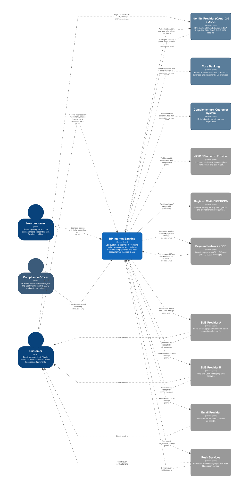
<em>Cómo leerlo.</em> Las personas (clientes, cliente potencial y personal de operaciones y cumplimiento) usan BP Internet Banking. El sistema se apoya en tres sistemas internos de BP (Core, sistema complementario, servidor OAuth 2.0) y en servicios externos: verificación de identidad, Registro Civil, red de pagos / BCE y proveedores de SMS, correo y push. Cada flecha dice para qué se usa.

### 4.2 Nivel 2 · Contenedores (cinco vistas del mismo modelo)

Figura 4.2a – Canales, borde, API Gateway y BFF
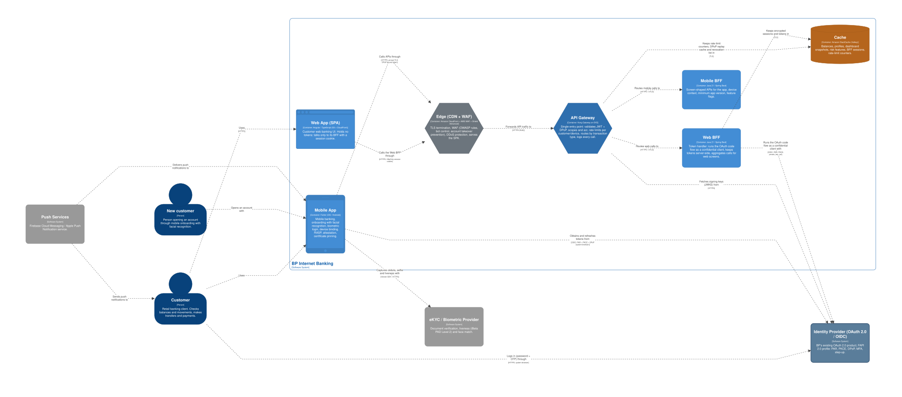
<em>Cómo leerlo.</em> La SPA, la app móvil y el portal de back-office entran por el borde y el API Gateway. El BFF web guarda los tokens en el servidor (el navegador solo tiene una cookie HttpOnly); la app móvil usa tokens ligados al dispositivo (DPoP).

Figura 4.2b – Transferencias y pagos
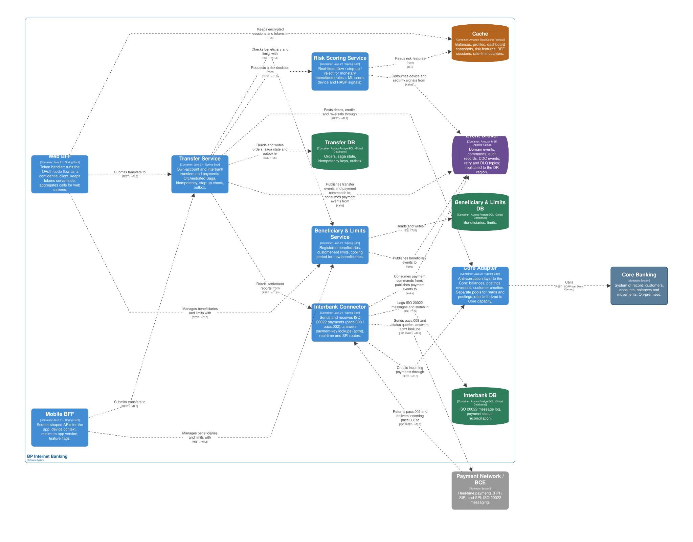
<em>Cómo leerlo.</em> Transfer orquesta la Saga: consulta límites y riesgo, debita por el Core Adapter y envía la orden por Kafka al conector interbancario (ISO 20022). Las líneas punteadas son eventos asíncronos.

Figura 4.2c – Acceso a datos y clientes frecuentes
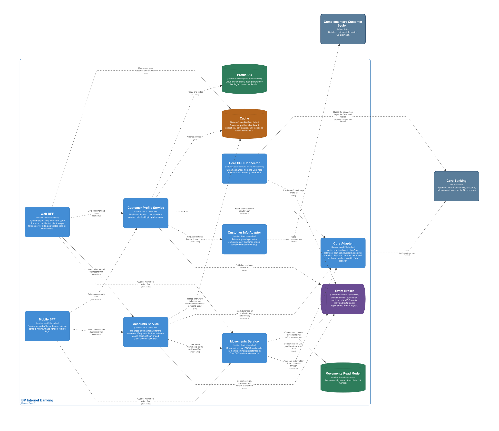
<em>Cómo leerlo.</em> Las lecturas salen de caché y del modelo de lectura (alimentado por CDC del Core); el Core solo se consulta al fallar la caché y con límite de tasa.

Figura 4.2d – Onboarding
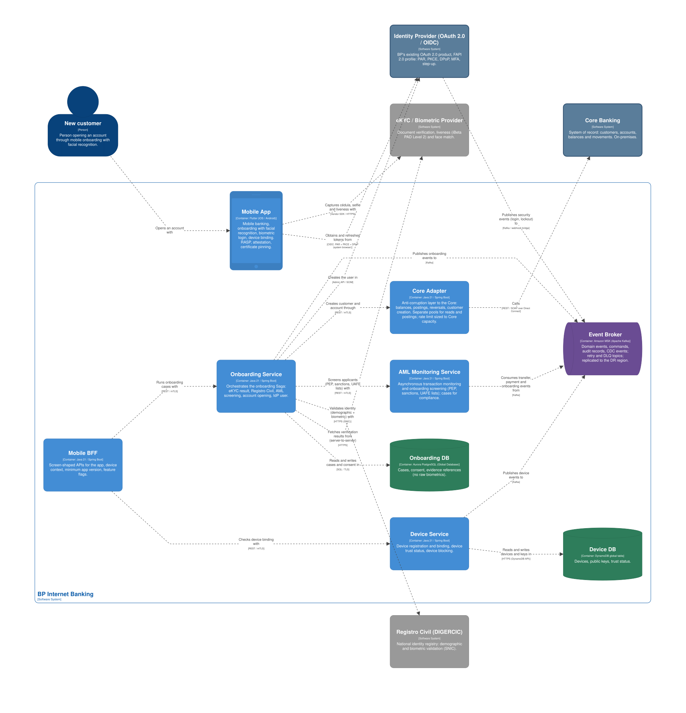
<em>Cómo leerlo.</em> El servicio de Onboarding combina el resultado del proveedor eKYC, el Registro Civil y el screening AML; abre la cuenta en el Core y crea el usuario. El personal revisa los casos dudosos desde el back-office.

Figura 4.2e – Notificaciones y auditoría
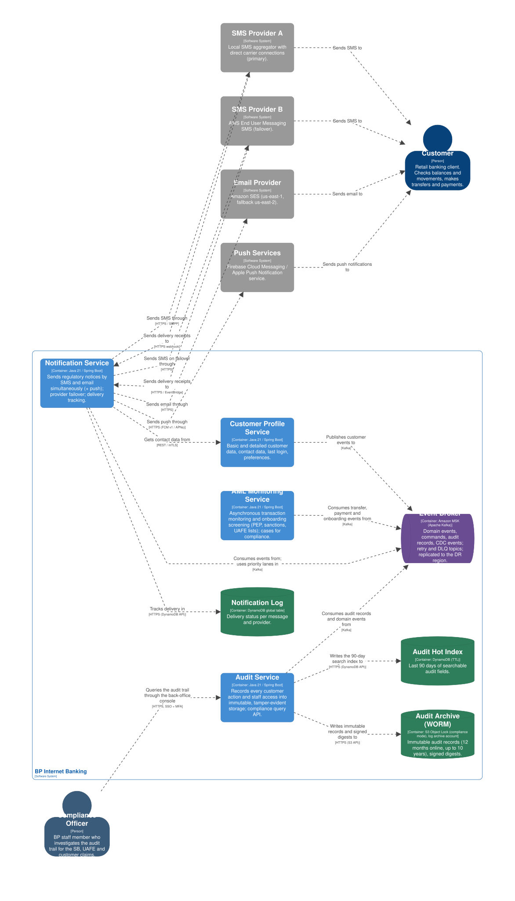
<em>Cómo leerlo.</em> Ambos servicios escuchan eventos de Kafka: no frenan ni rompen una transferencia si fallan. Auditoría escribe en almacenamiento inmutable y se consulta desde el back-office.

### 4.3 Nivel 3 · Componentes

Seis contenedores, agrupados en **capas** (API → negocio → integración y datos). **Límites de seguridad** en todas las vistas: (1) internet → gateway: TLS, WAF, JWT + DPoP; (2) gateway → servicio: mTLS en red privada, identidad reenviada en el token; (3) servicio → datos y sistemas externos: endpoints privados, roles IAM por servicio, sin secretos en el código, tiempos de espera en cada llamada.

Figura 4.3a – API Gateway: cadena de políticas
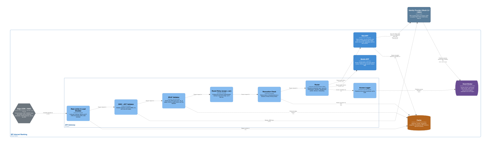
<em>Cómo leerlo.</em> Cada solicitud pasa en orden: límite de tasa, JWT, prueba DPoP, política de ruta (alcance y nivel de autenticación), lista de revocación y enrutador hacia un BFF o, para el personal, hacia las API de revisión, auditoría u operaciones. Cada llamada deja un registro de auditoría.

Figura 4.3b – Servicio de Transferencias y Pagos
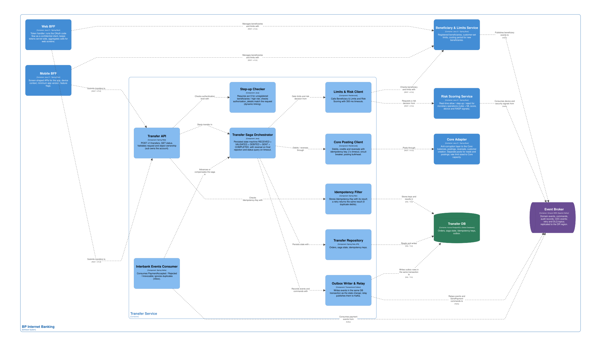
<em>Cómo leerlo.</em> API: autorización (alcance, propiedad de la cuenta, paso adicional) e idempotencia; responde 202 con URL de estado. Negocio: Saga orquestada, manejador de compensaciones y conciliación con el Core y los reportes de liquidación; lo no resuelto va a una cola de operaciones manuales. Integración y datos: repositorio con outbox transaccional y clientes con corte de circuito.

Figura 4.3c – Servicio de Onboarding
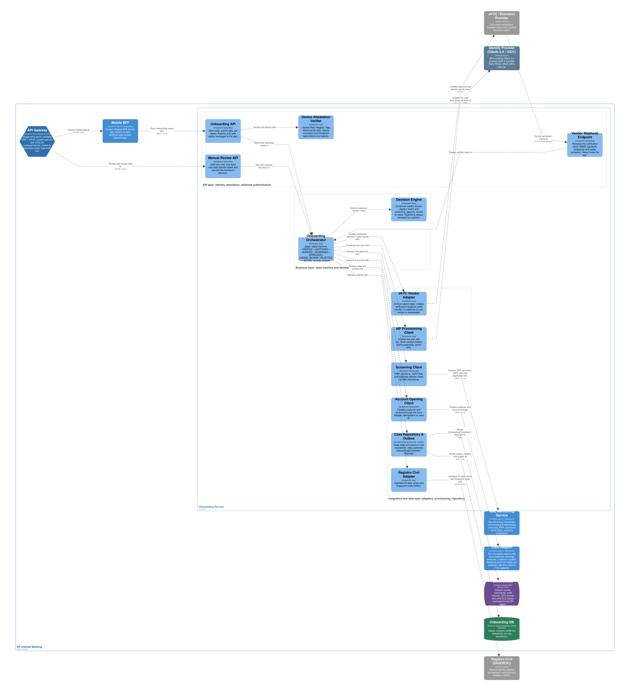
<em>Cómo leerlo.</em> El resultado del proveedor nunca se toma de la app: llega por un <b>webhook firmado (HMAC)</b> o se consulta si se pierde, y se combina con el Registro Civil y el screening. Una máquina de estados decide aprobar, revisar o rechazar; los dudosos y todos los rechazos van a revisión de cuatro ojos. Al aprobar, el usuario se crea con <code>kyc_level=verified</code>. La atestación del dispositivo bloquea emuladores y apps alteradas antes de capturar datos.

Figura 4.3d – Servicio de Cuentas: persistencia para clientes frecuentes
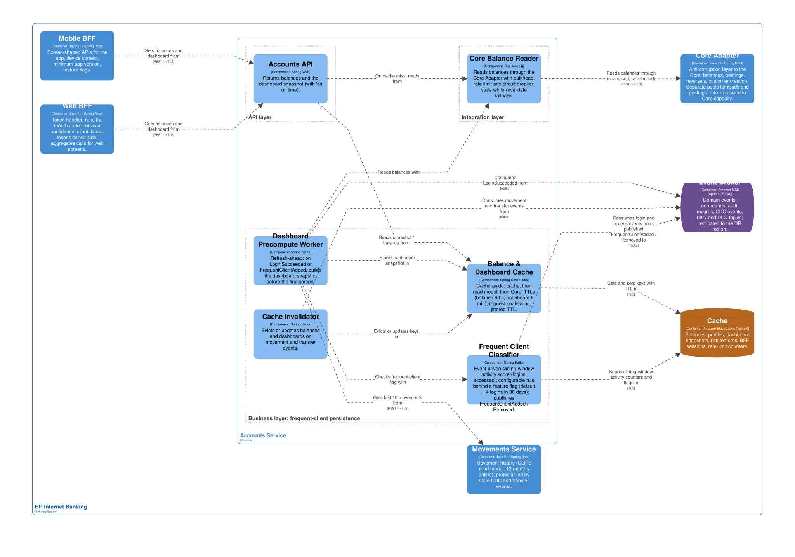
<em>Cómo leerlo.</em> El clasificador cuenta actividad en una ventana deslizante y anuncia <code>FrequentClientAdded / Removed</code>; el precalentador arma el tablero con ese evento y en cada ingreso; el invalidador mantiene los saldos al día; la lectura va caché → modelo de lectura → Core. El Core sigue siendo la fuente de verdad.

Figura 4.3e – Servicio de Notificaciones
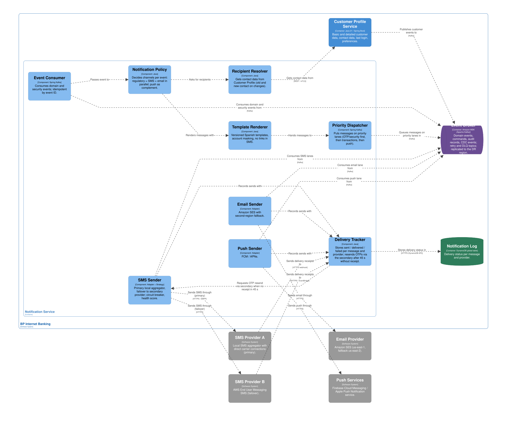
<em>Cómo leerlo.</em> Política (SMS + correo en paralelo para avisos regulatorios), plantillas con enmascaramiento, carriles de prioridad (OTP primero), adaptadores por proveedor con corte de circuito y reenvío por el SMS secundario si no hay confirmación en 45 s.

Figura 4.3f – Servicio de Auditoría
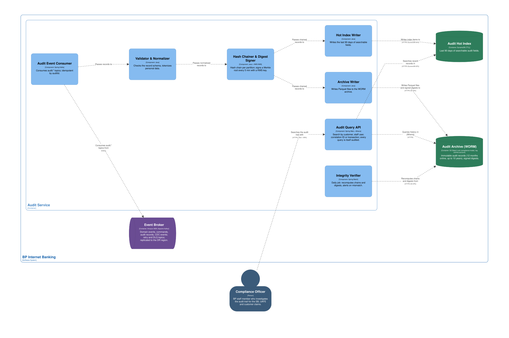
<em>Cómo leerlo.</em> Ingesta (valida, tokeniza, encadena hashes), almacenamiento (archivo WORM e índice de 90 días), consulta de solo lectura por rol (cada consulta queda auditada) y verificador diario de integridad.

### 4.4 Infraestructura y despliegue

Figura 4.4 – Producción en AWS: us-east-1 primaria (3 zonas), us-east-2 en espera, enlace híbrido al Core
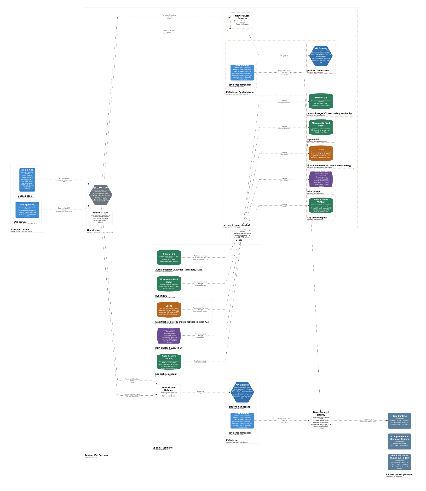
<em>Cómo leerlo.</em> Un elemento representativo por servicio de plataforma; las descripciones de los nodos listan todo lo desplegado. Datos replicados de forma continua a us-east-2 (Aurora Global Database, DynamoDB global tables, Global Datastore, MSK Replicator, S3 CRR); el Core se alcanza por Direct Connect. Cada región tiene su propia pila de <b>observabilidad</b> (colectores ADOT, Prometheus y Grafana gestionados, CloudWatch, X-Ray), así la región de respaldo ya está vigilada cuando empieza una conmutación. Latencia medida desde Cuenca: us-east-1 ~90 ms, us-east-2 ~103 ms, São Paulo ~157 ms. En una segunda medición de ambas nubes: AWS us-east-1 ~103 ms; Azure East US ~109 ms, México Central ~124 ms y <b>Chile Central ~178 ms</b> (el tráfico igual pasa por EE. UU.). La latencia no favorece a Azure.

### 4.5 Diagramas dinámicos

Figura 4.5a – Ingreso web (Authorization Code + PKCE + PAR mediante el BFF)
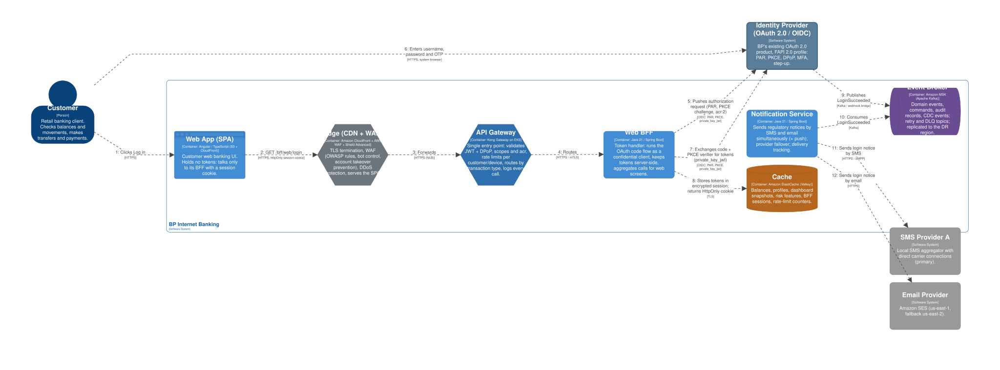

Figura 4.5b – Ingreso biométrico móvil con llave del dispositivo y tablero precalculado
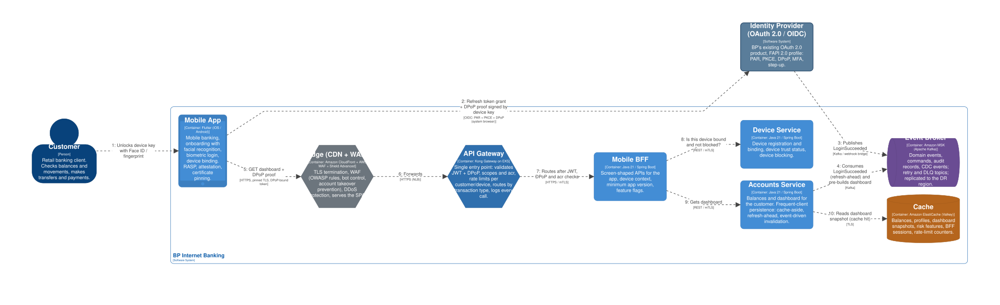

Figura 4.5c – Saga de onboarding con reconocimiento facial
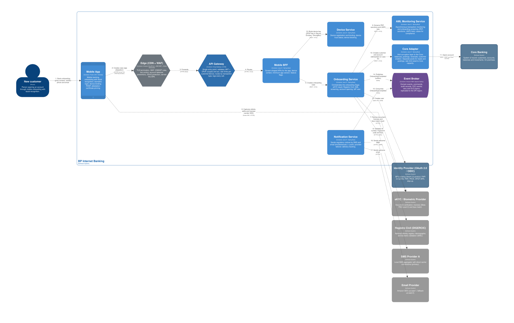

Figura 4.5d – Transferencia interbancaria en tiempo real
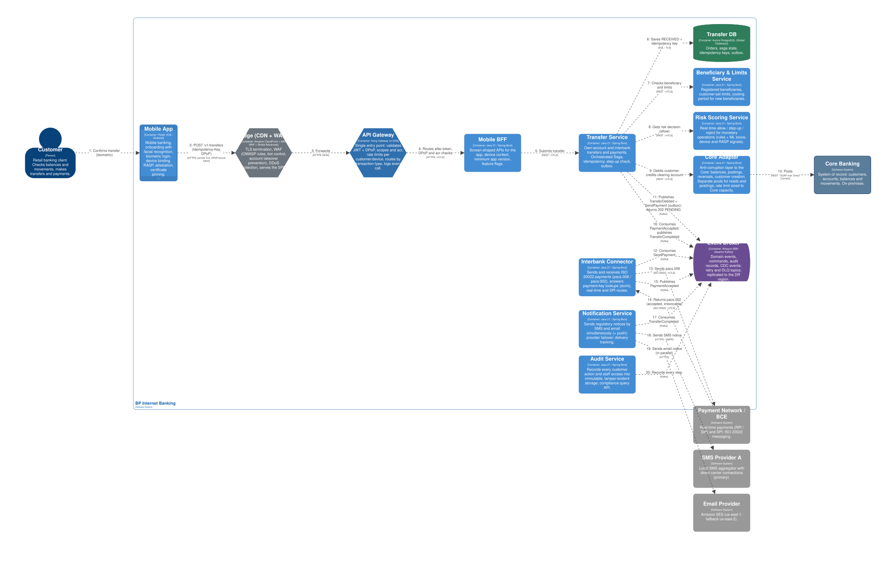

Figura 4.5e – Paso adicional con vinculación dinámica para transferir a un beneficiario nuevo (RFC 9470 + RFC 9396)
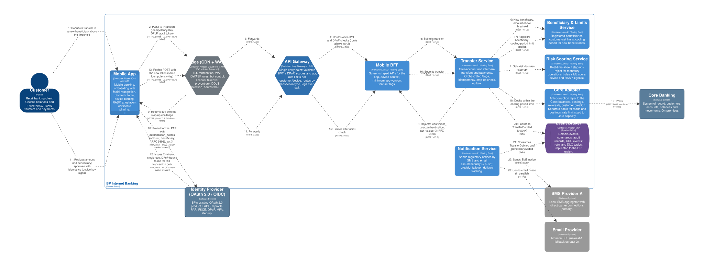
<em>Cómo leerlo.</em> La primera solicitud lleva un token <code>acr:2</code>, así que Transfer responde <code>insufficient_user_authentication</code>. La app vuelve a autorizar con el monto y el beneficiario en <code>authorization_details</code>; el cliente aprueba con biometría y el producto de identidad emite un token de 2 minutos, de un solo uso y válido solo para esa transacción. El reintento usa la misma clave de idempotencia: nunca hay doble débito.

## 5. Front-end y móvil

**SPA: Angular** (puntaje 4,65 frente a React 4,00 y Vue 3,95): framework completo y uniforme para formularios bancarios; **seguro por defecto** (sanitización, CSP estricta, Trusted Types); soporte predecible de 18 meses por versión. **El BFF web guarda los tokens en el servidor**: el navegador solo recibe una cookie `__Host-` HttpOnly, Secure, SameSite=Strict.

**Móvil: Flutter frente a React Native → Flutter** (4,20 frente a 4,00): código nativo compilado y ofuscado (más difícil de alterar, como pide la SB y OWASP MASVS-RESILIENCE); la misma interfaz y rendimiento en todos los equipos, incluso Android de gama baja; probado en banca latinoamericana (Nubank). React Native gana en disponibilidad de talento y queda como alternativa válida. **Seguridad móvil (MASVS L2 + R):** llaves en Secure Enclave / StrongBox, Play Integrity / App Attest verificados en el servidor, RASP comercial que alimenta el puntaje de riesgo, *pinning* de certificados, bloqueo de capturas en pantallas sensibles. **Micro-frontends descartados:** una SPA modular basta para ~10 % del tráfico.

## 6. Autenticación y autorización

**Flujo recomendado según el estándar: Authorization Code + PKCE + PAR, perfil FAPI 2.0, tokens ligados al remitente (DPoP).** Implícito y Resource Owner Password están descartados (RFC 9700).

| Flujo evaluado | Veredicto | Motivo |
| --- | --- | --- |
| Authorization Code + PKCE (+ PAR) | **Elegido** | Práctica actual para clientes públicos; evita la intercepción del código; el usuario nunca escribe su clave en la app |
| Implícito | Descartado | Tokens en la URL y el historial; retirado en OAuth 2.1 |
| Resource Owner Password | Descartado | La app manejaría la clave; rompe MFA y controles de riesgo |
| Client Credentials | Solo servicio a servicio | No hay usuario |

**Web:** el BFF es cliente confidencial (`private_key_jwt`). **Móvil:** navegador del sistema (RFC 8252), tokens DPoP con llave no exportable en hardware seguro. **Ingreso biométrico:** la huella o el rostro desbloquean la llave del dispositivo, que firma la renovación del token: dos factores (posesión + inherencia) y la biometría nunca sale del teléfono. **Segundo factor:** confirmación en la app o **OTP de la app (TOTP)**; el **OTP por SMS solo como respaldo** por el riesgo de *SIM swap*. Las passkeys sincronizadas no se usan en móvil porque romperían "solo dispositivos autorizados".

| Acción del cliente | Aseguramiento requerido |
| --- | --- |
| Ver saldos y movimientos; transferir entre cuentas propias | Llave del dispositivo con biometría (móvil) o clave + OTP (web) |
| Transferir a un beneficiario registrado bajo el umbral | Igual que arriba |
| Monto sobre el umbral o beneficiario nuevo | **Paso adicional ligado a la transacción** (monto y beneficiario: RFC 9470 + 9396) con firma biométrica en la app o TOTP, y periodo de espera para beneficiarios nuevos (Figura 4.5e) |
| Cambiar dispositivo, clave o contacto; recuperar la cuenta | Clave + OTP **y** reverificación facial con prueba de vida (+ Registro Civil); aviso al contacto anterior y al nuevo |

Reglas de la SB: bloqueo tras 3 intentos con aviso inmediato, aviso de cada ingreso, fecha del último ingreso, cierre por inactividad. **Autorización:** el gateway valida firma, emisor, audiencia, vigencia, **prueba DPoP**, alcances y nivel mínimo por ruta; cada servicio verifica que la cuenta pertenezca a quien llama (OWASP API1); entre servicios, mTLS.

## 7. Onboarding con reconocimiento facial

Verificaciones: autenticidad de la cédula → **prueba de vida** (iBeta PAD nivel 2, ISO/IEC 30107-3) y defensa contra inyección → **coincidencia facial** con el documento → **Registro Civil (SNIC)** demográfico + biométrico (US$ 0,30 por consulta) → mayoría de edad → **screening PEP / sanciones / UAFE** → OTP de teléfono y correo → **consentimiento** explícito.

**Proveedor:** se compra una plataforma eKYC especializada (prueba de concepto con **FacePhi**, que ya valida contra el Registro Civil de Ecuador, y **Jumio** como alternativa; ambos tienen carta de conformidad **iBeta ISO/IEC 30107-3 nivel 2**) en lugar de construir sobre servicios de rostro genéricos, que no verifican la cédula. El banco mantiene su propio contrato con el Registro Civil. **Componentes (Figura 4.3c):** atestación del dispositivo, **webhook firmado** con protección contra repetición, máquina de estados, motor de decisión, **revisión de cuatro ojos**, creación del usuario con `kyc_level=verified`. **Datos biométricos:** imágenes eliminadas tras la decisión, **sin plantillas faciales almacenadas**, evidencia y consentimiento en el archivo inmutable, evaluación de impacto anual, nunca decisiones solo automatizadas, sin menores.

## 8. Capa de integración y transferencias

| Decisión | Elegido | Alternativas | Justificación |
| --- | --- | --- | --- |
| API Gateway | **Kong en EKS** | Amazon API Gateway, Apigee, Azure APIM | Validación DPoP / FAPI como plugins; costo plano con miles de millones de solicitudes; configuración portable en Git |
| Mensajería | **Amazon MSK (Kafka)** | Confluent Cloud, SQS/SNS/EventBridge | Reproducción de eventos; orden por cuenta; CDC en la misma plataforma |
| Cómputo | **Amazon EKS** (+ Lambda solo para tareas auxiliares) | ECS Fargate, Lambda | Portabilidad; auto-reparación y elasticidad; carga estable con conexiones largas al Core |

**Patrones:** tiempos de espera, reintentos con espera creciente (solo idempotentes), **corte de circuito**, **aislamiento (bulkhead)** de lecturas y escrituras hacia el Core, límite de tasa hacia el Core, **clave de idempotencia**, **outbox transaccional** y consumidor idempotente, **Saga orquestada**, **capa anticorrupción**, BFF, *strangler fig*, descarte de carga.

**Saga interbancaria:** `RECEIVED → VALIDATED → DEBITED → SENT → COMPLETED`. El BCE exige **debitar antes** de enviar el `pacs.008`; un rechazo final (`pacs.002`) dispara la **reversión**; un vencimiento deja el estado **UNKNOWN** y se consulta a la red (nunca se revierte a ciegas un pago posiblemente irrevocable). El cliente recibe **202 con URL de estado** en < 3 s. Un **manejador de compensaciones**, una **tarea de conciliación** contra el Core y los reportes de liquidación y una **cola de operaciones manuales** cierran los casos raros. El conector también **recibe** pagos entrantes y responde dentro del tiempo de la red.

## 9. Acceso a datos y clientes frecuentes

**Almacenes:** Aurora PostgreSQL (transaccional, outbox e idempotencia en una transacción), DynamoDB (modelo de lectura de ~4 000 millones de movimientos, dispositivos), ElastiCache Valkey (caché); una base por servicio. **CDC con Debezium** sobre una réplica de lectura del Core: datos frescos en segundos sin tocar el código del Core, más conciliación nocturna.

**Persistencia para clientes frecuentes (patrones):**

| Patrón | Aplicado a | Efecto |
| --- | --- | --- |
| **Clasificador por eventos** | Ventana deslizante de actividad; regla configurable con bandera (por defecto ≥ 4 ingresos en 30 días) | Publica `FrequentClientAdded / Removed` |
| **CQRS (modelo de lectura)** | Movimientos, 13 meses en DynamoDB | El historial nunca consulta al Core |
| **Cache-Aside** | Saldos (60 s), perfil (24 h), tablero (5 min) | La mayoría de lecturas desde memoria |
| **Invalidación por eventos** | Movimientos, transferencias, pagos entrantes | Sin saldos desactualizados |
| **Precalentamiento + vista materializada** | Al volverse frecuente o al ingresar | El primer pantallazo ya está listo |

Si el Core falla, el cliente sigue viendo saldos y movimientos "al hh:mm". Un saldo en caché **solo se muestra**: el Core valida el saldo disponible al debitar.

## 10. Auditoría

Se registra **cada acción del cliente** (incluidas las consultas), eventos de seguridad, evidencia de onboarding y consentimiento, y **cada acceso del personal a datos de clientes**, con los campos mínimos de la SB (fecha, hora, monto, cuentas y bancos, número de transacción, contactos notificados, OTP usado, IP). **Diseño:** eventos por outbox + registros de acceso del gateway + interceptor `@Audited` → Kafka → Servicio de Auditoría (valida, tokeniza, **encadena hashes**) → **S3 Object Lock en modo cumplimiento** en una cuenta separada (nadie, ni el administrador raíz, puede borrar antes de la retención) + índice de 90 días; **resúmenes firmados con KMS** cada 5 minutos y verificación diaria. **Retención:** 12 meses en línea, hasta 10 años archivado. **Descartados:** Event Sourcing completo (complejidad sin beneficio proporcional), Aurora con pgAudit (un DBA puede cambiar filas) y **Amazon QLDB (retirado en julio de 2025)**.

## 11. Notificaciones

Los dos sistemas regulatorios son **SMS y correo, enviados en paralelo**; push y bandeja en la app son complementos. **SMS:** agregador local (conexión directa con Claro, Movistar y CNT) con conmutación a **AWS End User Messaging**; **correo:** Amazon SES (segunda región de respaldo). **Componentes:** consumidor idempotente, política por evento, plantillas con enmascaramiento y sin enlaces en SMS, **carriles de prioridad** (OTP primero), adaptadores por proveedor (patrón Strategy) con corte de circuito, seguimiento de entregas y reenvío de OTP por el proveedor secundario si no hay confirmación en 45 s. No se usa Amazon Pinpoint (fin de soporte el 30 de octubre de 2026).

## 12. Seguridad

Confianza cero (NIST SP 800-207) y defensa en profundidad: **cliente** (MASVS, RASP, atestación, *pinning*; BFF y CSP en web), **borde** (CloudFront, WAF con reglas OWASP, control de bots y protección contra toma de cuentas, Shield Advanced), **API** (Kong: JWT + DPoP, alcances, nivel de autenticación, límites por cliente y dispositivo), **identidad** (FAPI 2.0, 2 de 3 factores, paso adicional, vinculación de dispositivo; personal con SSO y MFA FIDO2), **servicios** (mTLS con Istio, autorización a nivel de objeto, puntaje de riesgo antes de mover dinero), **red** (subredes privadas, endpoints privados, firewall de salida con lista permitida, Direct Connect cifrado), **datos** (KMS por dominio, CloudHSM, cifrado por campo, tokenización, enmascaramiento), **detección** (CloudTrail, GuardDuty, Security Hub → SIEM y SOC del banco) y **cadena de suministro** (SAST, SCA + SBOM, imágenes firmadas y control de admisión, DAST, pruebas de penetración anuales). **Antifraude:** decisión permitir / paso adicional / rechazar en ≤ 300 ms con señales de dispositivo, comportamiento, velocidad y beneficiario; límites y periodo de espera para beneficiarios nuevos.

## 13. Alta disponibilidad, tolerancia a fallos, DR y auto-reparación

**HA:** ≥ 3 réplicas por servicio crítico repartidas en 3 zonas con capacidad N+1; conmutación de Aurora < 30 s; Kafka con 3 réplicas; desplazamiento automático fuera de una zona degradada. **DR en caliente en us-east-2** para lo crítico (piloto para el resto de T2, respaldo y restauración para T3): datos ya replicados y cómputo reducido en marcha; la conmutación la **decide una persona y la ejecuta un plan automatizado** (ARC Region switch) en ≈ 12–15 min. Activo-activo se descartó: duplica el costo y las transferencias necesitan un solo escritor (el Core es un solo sitio). **Degradación elegante:** Core caído → saldos y movimientos "al hh:mm" y transferencias rechazadas con claridad; un proveedor SMS caído → conmutación; Notificaciones o Auditoría caídos → los eventos esperan en Kafka. **Auto-reparación:** sondas de vida y preparación, reemplazo automático de nodos, escalado por carga y por cola, despliegues canario con reversión automática, GitOps. **Pruebas:** caos mensual en *staging*, simulacro de caída de zona trimestral y **conmutación regional completa dos veces al año**; respaldos aislados con bloqueo de bóveda contra *ransomware*.

## 14. Monitoreo y excelencia operativa

**OpenTelemetry** en todos los servicios hacia Prometheus, trazas y registros gestionados de AWS y Grafana. El **ID de correlación es el ID de traza**, propagado también en los encabezados de Kafka y guardado en la auditoría. **SLO** por flujo con **presupuesto de errores** (si se agota, se detienen los lanzamientos), alertas por velocidad de consumo cada minuto (≤ 5 min), pruebas sintéticas desde fuera, paneles de negocio (transferencias por minuto, embudo de onboarding, entrega de notificaciones, latencia del Core, costo de SMS). **Operación:** Terraform / OpenTofu, GitOps con Argo CD, canario 5 % → 100 % con reversión automática, banderas de funcionalidad, migraciones *expand/contract*, congelamiento en días de pago, cambios estándar pre-aprobados con evidencia automática para auditoría, manuales por alerta y revisiones sin culpables.

## 15. Costos

Estimación mensual a escala completa. **Precios unitarios verificados el 8 de noviembre de 2026 en la AWS Price List pública** (us-east-1, bajo demanda; CloudFront Sudamérica). Verificado = precio unitario comprobado; Parcial = precio comprobado con volumen supuesto; Estimado = requiere cotización. **Volumen de avisos:** ~225 M al mes, cada uno por SMS **y** correo: ~164 M transacciones monetarias más ~60 M avisos de ingreso (cerca de uno por usuario activo al día; la SB exige avisar cada ingreso y se usan los mismos dos canales que para el dinero). Detalle línea por línea y cómo reproducir cada consulta: `roadmap-steps/16b-cost-validation.md`.

| Componente | Precio unitario | US$ / mes | Estado |
| --- | --- | --- | --- |
| Cómputo: EKS (2 clústeres) + ~65 nodos m7g.xlarge, Savings Plan en la base | 0,10 / clúster-h; 0,1632 / nodo-h | ≈ 6 850 | Verificado |
| Aurora PostgreSQL: 5 clústeres + Global Database, almacenamiento, E/S | 1,106 / h (r7g.2xlarge), 0,276 / h (r7g.large) | ≈ 6 150 | Verificado / Parcial |
| DynamoDB: modelo de lectura, dispositivos, notificaciones, índice de auditoría | 0,625 / M escrituras; 0,25 / GB-mes | ≈ 8 100 | Parcial |
| ElastiCache Valkey: 9 nodos r7g.xlarge | 0,3496 / nodo-h | ≈ 2 300 | Verificado |
| MSK: 9 brokers m7g.xlarge, almacenamiento, Replicator | 0,408 / broker-h | ≈ 4 100 | Parcial |
| Red: 2 Direct Connect 10G, Network Firewall, NAT / TGW / endpoints | 2,25 / puerto-h; 0,395 / endpoint-h | ≈ 7 800 | Verificado / Estimado |
| Borde: CloudFront, WAF, control de bots, protección de login (~5 M), Shield Advanced | 0,022 / 10 mil solicitudes; 1,00 / mil logins; 3 000 / mes | ≈ 18 200 | Verificado / Parcial |
| Seguridad: CloudHSM (4) + GuardDuty, Security Hub, Inspector, Macie, KMS | 1,60 / HSM-h | ≈ 9 700 | Verificado / Estimado |
| Observabilidad | Por uso | ≈ 10 000 | Estimado |
| Almacenamiento y respaldos | Por uso | ≈ 1 500 | Estimado |
| Correo: Amazon SES, ~225 M (transacciones + ingresos) | 0,10 / mil | ≈ 22 500 | Verificado |
| **Producción** | | **≈ 97 000** (> 60 % con precios verificados) | |
| No productivo (apagado programado) | | ≈ 20 000–25 000 | Estimado |
| **Total AWS** | | **≈ 117 000–122 000** (≈ US$ 0,02 por usuario activo) | |

**Fuera de AWS:** SMS ≈ **US$ 1,1–4,5 millones al mes** por ~225 M mensajes a US$ 0,005–0,02, según el precio negociado (de 9 a 38 veces toda la factura de AWS; solo los avisos de ingreso son ≈ US$ 0,3–1,2 millones), Registro Civil ≈ US$ 15 mil, proveedor eKYC y licencias por cotizar. **DR en caliente** ≈ US$ 10–12 mil al mes (frente a ≈ 50–60 mil de activo-activo). **Palancas:** precio del SMS y push donde la SB lo acepte; compromisos sobre la base (Savings Plans, reservas); Graviton; apagado de entornos no productivos; índice de auditoría en una sola región (≈ US$ 3 mil al mes menos); FinOps con etiquetas, presupuestos y costo por usuario y por transacción.

## 16. Plan de entregas y evolución

Esta arquitectura es el **destino**. No se construye entera antes de que el primer cliente la vea: se llega en **cuatro etapas** y cada una debe probar algo antes de pagar la siguiente.

| Etapa | Técnica | Alcance | Costo AWS (US$ / mes) |
| --- | --- | --- | --- |
| **1. Pretotipo** | *Fake Door* (botón de transferencias que mide intención y responde "próximamente"), *Pinocchio* (app navegable), *Mechanical Turk* (el personal revisa a mano) | App y SPA sobre el gateway hacia **endpoints simulados desde los contratos OpenAPI**; eKYC en el entorno de pruebas del proveedor. **Sin Core, sin datos reales** | 1 000–2 000 |
| **2. MVP de solo lectura** | Valor real con bajo riesgo | Perfil, Cuentas y Movimientos con **arquitectura hexagonal**; integración real con Core e identidad; ingreso biométrico; auditoría básica; una región multi-zona; piloto | 15 000–25 000 |
| **3. Transaccional** | Expansión iterativa: primero cuentas propias, luego interbancarias, por cohortes y con banderas | Saga, idempotencia, outbox, límites, riesgo, notificaciones, auditoría completa, Kafka, onboarding real, paso adicional; **DR en caliente antes de abrir transferencias fuera del piloto** | 60 000–80 000 (+ SMS) |
| **4. Escala empresarial** | Endurecimiento según carga medida y regulador | Multi-región completa, clientes frecuentes a escala, Shield Advanced, CloudHSM, caos y simulacros, push para reducir SMS | 117 000–122 000 (+ SMS) |

| Puerta | Hipótesis («al menos X % de Y hará Z»; umbrales a ajustar con Producto) | Si falla |
| --- | --- | --- |
| Fin etapa 1 | ≥ 70 % del piloto completa ingreso y onboarding sin ayuda; ≥ 25 % toca "Transferencias" en dos semanas | Cambiar el flujo; no construir la integración |
| Fin etapa 2 | ≥ 40 % del piloto consulta cada semana; lectura p95 en meta; sin incidentes graves en 4 semanas | Corregir experiencia o rendimiento antes de agregar funciones |
| Fin etapa 3 | ≥ 15 % de los activos transfiere en el primer mes; éxito ≥ 99,5 %; notificaciones ≥ 99 % | Mantener transferencias tras la bandera y arreglar la fiabilidad |
| Fin etapa 4 | SLO cumplidos dos meses seguidos; simulacro regional dentro de RTO / RPO | Seguir endureciendo antes de ampliar el lanzamiento |

**Umbral mínimo de resiliencia:** la etapa 1 no maneja datos reales; la 2 exige multi-zona, respaldos con restauración probada e infraestructura como código; antes de abrir transferencias fuera del piloto hace falta DR en caliente y un primer simulacro (o una aceptación de riesgo firmada).

| Deuda técnica aceptada | Se paga cuando |
| --- | --- |
| Endpoints simulados (etapa 1) | La etapa 2 los reemplaza y se eliminan |
| Publicador de eventos en proceso (etapa 2) | La etapa 3 incorpora Kafka tras el mismo puerto |
| Una sola región con restauración (etapa 2) | DR en caliente antes de abrir transferencias |
| Sin precalentamiento ni clasificador hasta la etapa 4 | Las mediciones muestran lentitud del Core o del día de pago |
| Sin canal push | El costo del SMS lo justifica y la SB lo acepta |

Contratos primero (OpenAPI, esquemas de Kafka), enrutamiento por ruta o cohorte en el gateway y arquitectura hexagonal hacen intercambiables una maqueta y un servicio real sin reescribir las apps. Una prueba de intención en un banco debe ser honesta y revisada por Legal y Cumplimiento.

## 17. Registro de decisiones

Cada decisión tiene al menos dos justificaciones y las alternativas evaluadas; el texto completo está en las notas del repositorio (`roadmap-steps/`). **Estado:** la ADR-001 (herramienta de diagramas) está *aceptada*; de la 002 a la 022 están *propuestas*: recomendadas por el arquitecto y pendientes de aprobación por el comité de arquitectura de BP. La ADR-008 además depende de la prueba de concepto del proveedor.

| ADR | Decisión | Alternativas descartadas | Justificaciones |
| --- | --- | --- | --- |
| 001 | Structurizr DSL para C4 | draw.io, C4-PlantUML, IcePanel | Un modelo → vistas coherentes; diagramas como código en Git |
| 002 | AWS | Azure | Latencia igual o mejor que Azure (misma medición: us-east-1 ~103 ms frente a Azure East US ~109 ms y Chile Central ~178 ms); servicios multi-región gestionados para RPO/RTO |
| 003 | us-east-1 primaria, us-east-2 DR | São Paulo; us-east-1 + sa-east-1; una sola región | Latencia; región de DR con riesgos distintos (SB) y ~103 ms |
| 004 | Microservicios por contexto (gruesos) | Monolito modular; microservicios finos | Escalado independiente; aislamiento de fallas; límites de datos por norma |
| 005 | Angular | React, Vue | Framework completo; seguro por defecto; soporte predecible |
| 006 | Flutter | React Native | Resistencia a manipulación; UI uniforme; probado en banca LATAM |
| 007 | Code + PKCE + PAR, FAPI 2.0, DPoP, BFF; TOTP / app y SMS de respaldo | ROPC, Implícito, tokens en el navegador, passkeys sincronizadas en móvil, solo SMS | Token robado inútil; un modelo para ambos canales; estándar de banca abierta; biometría en el equipo |
| 008 | Proveedor eKYC (PoC FacePhi / Jumio) + Registro Civil | Construir sobre Rekognition | Documento + registro + vida juntos; evidencia certificada; reemplazable |
| 009 | Kong en EKS | Amazon API Gateway, Apigee, Azure APIM | Plugins DPoP / FAPI; costo plano; configuración portable |
| 010 | Amazon MSK (Kafka) | Confluent Cloud, SQS/SNS/EventBridge | Reproducción; orden por clave; CDC en la misma plataforma |
| 011 | Amazon EKS | ECS Fargate, Lambda | Portabilidad; auto-reparación y elasticidad; carga estable |
| 012 | Aurora + DynamoDB + ElastiCache | Base compartida, DocumentDB, OpenSearch | Almacén adecuado a cada carga; replicación gestionada; pocas tecnologías |
| 013 | CQRS + Cache-Aside + invalidación + precalentamiento | Llamar siempre al Core; solo caché; réplica completa | Tablero rápido y Core protegido; los patrones se cubren entre sí; tolerancia a fallas |
| 014 | CDC con Debezium sobre réplica del Core | Replicación del proveedor, consulta periódica, archivos | Datos frescos sin tocar el Core; baja carga |
| 015 | Outbox + Kafka → S3 Object Lock + índice, cadena de hashes | DynamoDB, OpenSearch, pgAudit, QLDB (retirado), Event Sourcing | Inmutabilidad real; sin pérdida ni bloqueo; 10 años asequibles; evidencia de manipulación |
| 016 | SMS + correo en paralelo, 2 proveedores SMS | Twilio, Infobip, SendGrid, Pinpoint (retirado) | Dos sistemas independientes; respaldo del OTP; precio local |
| 017 | Servicios de seguridad de AWS → SIEM del banco | Solo herramientas de terceros | Cobertura nativa; un solo SOC; evidencia continua |
| 018 | DR en caliente con ARC Region switch | Respaldo, piloto, activo-activo | RTO/RPO a costo razonable; un solo escritor para el dinero; sitio alterno (SB) |
| 019 | OpenTelemetry + Prometheus / Grafana gestionados | Datadog, Dynatrace, Grafana propio | Neutral al proveedor; telemetría en la cuenta; costo por uso |
| 020 | Terraform / OpenTofu | AWS CDK, CloudFormation | Multi-proveedor; plan como evidencia de cambio; portable |
| 021 | Compromisos sobre la base + autoescalado + Graviton + FinOps | Solo bajo demanda; compromiso total | Base predecible; mejor precio-rendimiento; costo visible por equipo |
| 022 | Entrega en 4 etapas con puertas y registro de deuda | Entrega única; prototipo y reescritura | Evidencia antes de invertir; costo y riesgo crecen con la demanda; sin reescritura |

## 18. Riesgos y temas abiertos

| Riesgo o supuesto | Mitigación | Responsable |
| --- | --- | --- |
| Costo del SMS al volumen regulatorio (~225 M al mes con los avisos de ingreso) | Negociar precio local; consultar a la SB si push a un dispositivo vinculado cuenta como mensajería móvil, empezando por los avisos de ingreso (≈ US$ 0,3–1,2 millones al mes) | Producto, Compras, Cumplimiento |
| Datos personales alojados fuera de Ecuador | Contrato de encargo con cláusulas, llaves del banco, registro; alternativa híbrida | Legal, Delegado de datos |
| Capacidad y disponibilidad del Core | Caché, CQRS, límites, aislamiento, degradación elegante | Arquitectura, equipo del Core |
| Capacidades FAPI del servidor de autorización (PAR, DPoP, RAR) | Agregarlas en el gateway o elegir un producto certificado | Seguridad, Arquitectura |
| Identidad y enlace a la red de pagos disponibles desde ambas regiones | Requisito de DR declarado | Infraestructura |
| *SIM swap* sobre el OTP por SMS | TOTP / confirmación en la app primero; SMS de respaldo | Seguridad, Fraude |
| Precisión del eKYC con cédulas reales y teléfonos de gama baja; SDK Flutter | Prueba de concepto antes de contratar; proveedor alterno tras el adaptador | Producto, Compras |
| Investigación por filtración de datos biométricos del Registro Civil (2026) | La coincidencia con el registro siempre se combina con prueba de vida en el momento | Fraude, Cumplimiento |
| Detalles normativos (artículos SB, retención UAFE, artículos JPRF, estándares de ciberseguridad) | Revisión legal antes de producción | Legal, Cumplimiento |
| Regiones de nube más cercanas: Azure Chile Central resultó más lenta (~178 ms, pasa por EE. UU.); la región de AWS en Chile está anunciada para fines de 2026, aún no abierta | Volver a medir desde Quito y Guayaquil y cuando abra AWS Chile; el diseño portable permite moverse | Arquitectura |
| Habilidades del equipo (Flutter, Kubernetes, Kafka) | Equipo de plataforma, plantillas de servicio (*golden paths*), capacitación | Gerencia de ingeniería |

## 19. Trazabilidad con los criterios de evaluación

| Criterio | Dónde |
| --- | --- |
| 1. Requisitos cumplidos y justificados | §1, §2, §17 (22 decisiones con ≥ 2 justificaciones) |
| 2. Calidad y profundidad de los diagramas | §4 (contexto, 5 vistas de contenedores, 6 de componentes por capas, despliegue, 5 dinámicos) |
| 3. Segmentación de responsabilidades y desacople | §4, §8 |
| 4. Patrones de arquitectura | §8, §9, §10, §11 |
| 5. Integración con servicios externos | §7, §8, §11 |
| 6. Front-end y móvil | §5 |
| 7. Acceso a datos | §9 |
| 8. Nube (AWS) | §4.4, §8, §13 |
| 9. Costos | §15, §16 |
| 10. Autenticación | §6, Figuras 4.5a, 4.5b y 4.5e |
| 11. Integración del onboarding | §7, Figuras 4.3c y 4.5c |
| 12. Auditoría | §10, Figura 4.3f |
| 13. Regulación y estándares de seguridad | §3, §12 |
| 14. Alta disponibilidad y tolerancia a fallos | §13 |
| 15. Monitoreo | §14 |

**Repositorio público:** este PDF, la versión extendida en inglés, el modelo C4 (`architecture/workspace.dsl`) con los diagramas en PNG y SVG, las notas por paso con fuentes (`roadmap-steps/`), la validación de costos y el plan de entregas.
