

# BP Internet Banking

## Solution Architecture Proposal

Online and mobile banking platform: movement history, own-account and interbank transfers and payments, mobile onboarding with facial recognition.

**Solution Architect practical exercise** · November 2026

C4 model (Structurizr DSL) · AWS · Ecuador regulatory context

José Luis León · joleonca@gmail.com

## Contents

1. Executive summary
2. Context, requirements and assumptions
3. Regulatory considerations (Ecuador)
4. Architecture overview and C4 diagrams
5. Front-end and mobile architecture
6. Authentication and authorization
7. Onboarding with facial recognition
8. Integration layer and communication patterns
9. Data access and frequent-client persistence
10. Audit solution
11. Notifications
12. Security architecture
13. High availability, fault tolerance, DR and auto-healing
14. Monitoring and observability
15. Operational excellence
16. Cost management
17. Delivery plan and evolution
18. Architecture decision log (ADR-001 … ADR-022)
19. Risks, open questions and future evolution
20. Requirement and grading-criteria traceability

## 1. Executive summary

### The problem and why this project

Customers expect to do their banking from their phone or computer, at any hour, without visiting a branch. BP needs to offer that **securely, within the regulation and on top of the systems it already has**: service at any time (customers check, transfer and pay by themselves), new customers acquired remotely (opening an account from the phone reaches people without opening branches), compliance and trust (the regulation requires notifying every movement and keeping a reliable record of everything), and a base to grow on (what is built is reused by new products, and spend grows only as customers use it).

| Business need | What is expected |
| --- | --- |
| Secure self-service | Check and move money by themselves, at any hour, with bank-grade security |
| New customers without a branch | Open an account from the phone with a photo of the cédula and a live selfie, identity verified |
| Reuse what BP already has | Core platform, complementary customer system, existing OAuth 2.0 product |
| Notify every movement | Inform the customer through at least two channels, as the regulation requires |
| Traceability and compliance | Record everything customers do; comply with data protection, security and AML rules |
| Always available | Doesn't go down, recovers from a disaster, is monitored, and is fast |

| Business process | What the customer or the bank achieves | Decisions |
| --- | --- | --- |
| Onboarding | Open an account from the phone with cédula, live selfie and fingerprint code | ADR-008, 007 |
| Authentication (web and mobile) | Sign in securely with biometrics, or password plus a second factor | ADR-005, 006, 007 |
| Balances and movements | See balances and history fast, even faster for frequent clients | ADR-012, 013, 014 |
| Own-account transfers and payments | Move money between own accounts instantly | ADR-010, 011 |
| Interbank transfers and payments | Send money to other banks with clear status and no duplicates | ADR-009, 010 |
| Audit | Tamper-proof record of every action, for regulators and disputes | ADR-015 |
| Notifications | SMS and email for every movement | ADR-016 |

> The statement doesn't describe BP's current digital channel; the qualitative benefits above should be validated with the business sponsor.

**How to read this document.** Section 2–3: requirements, assumptions and regulation. Section 4: the C4 diagrams. Sections 5–11: detailed designs. Sections 12–16: security, resilience, monitoring, operations, cost. Section 17: how the target is reached in stages. Section 18: all decisions with alternatives and justifications.

### Proposal

BP (assumed to be **Banco Pichincha**, the largest private bank in Ecuador, ~6.5 M customers, ~5.2 M mobile-app users) needs an internet banking platform for a web SPA and a multiplatform mobile app. Customers check their movement history and make own-account and interbank transfers and payments; new customers open accounts from the app with facial recognition. Every movement must be notified, every action audited, and the platform must be highly available, secure and low-latency. The bank's 2025 app outages (supervised by the Superintendencia de Bancos, followed by a deposit run) make **resilience the first design driver**.

**Key decisions**

| Area | Decision |
| --- | --- |
| Cloud | **AWS**, primary **us-east-1** (lowest AWS latency measured from Ecuador, ~90 ms), **warm standby in us-east-2**; hybrid link to the on-premises Core with 2 Direct Connect links + VPN |
| Architecture style | **Microservices by bounded context** (14 domain services, coarse-grained), BFF per channel, event-driven support services |
| Front-end | **Angular** SPA (no tokens in the browser, BFF token handler) and **Flutter** mobile app (compared with React Native) |
| Authentication | OAuth 2.0 **Authorization Code + PKCE + PAR**, **FAPI 2.0** profile, **DPoP** sender-constrained tokens; biometric login through a **device-bound key** in the Secure Enclave / StrongBox; **step-up with dynamic linking** for transfers to new beneficiaries |
| Onboarding | Specialist **eKYC vendor** (FacePhi preferred, Jumio alternative, PoC) + **Registro Civil** biometric validation + AML screening, orchestrated as a **Saga**; no face templates stored |
| Integration | **Kong** API Gateway (single entry point), **Amazon MSK (Kafka)** event backbone, **EKS** compute, anti-corruption layers to the Core, complementary system and BCE payment network (**ISO 20022** `pacs.008` / `pacs.002`) |
| Frequent clients | **CQRS read model + cache-aside + event-driven invalidation + refresh-ahead** (dashboard p95 < 500 ms, Core protected) |
| Audit | Outbox + Kafka → Audit Service → **S3 Object Lock (WORM)** + hot index, **hash chain + signed digests** |
| Notifications | **SMS + email simultaneously** (regulation), 2 SMS providers with automatic failover, push as complement |
| Resilience | Multi-AZ, warm standby DR (**RTO 15 min / RPO 1 min** for critical journeys), auto-healing, chaos and DR drills |
| Cost | AWS ≈ **USD 117–122 k / month** at full scale (unit prices checked against the AWS Price List; ≈ USD 0.02 per active user); **SMS is the dominant running cost** |
| Delivery | **Four stages** (pretotype → read-only MVP → transactional → enterprise scale) with go/no-go gates, a minimum resilience line per stage and an explicit technical-debt register |

All decisions are recorded as **22 ADRs** (section 18), each with the alternatives evaluated and at least two justifications. The C4 model is a single **Structurizr DSL** workspace in the repository ([architecture/workspace.dsl](../architecture/workspace.dsl)), so every diagram is generated from one consistent model.

## 2. Context, requirements and assumptions

### 2.1 Functional requirements

| ID | Requirement | Source |
| --- | --- | --- |
| FR-01 | Mobile onboarding with **facial recognition** | Statement §3.5 |
| FR-02 | Login with username and password through the bank's **OAuth 2.0** product (SPA and mobile) | §3.4 |
| FR-03 | **Biometric login** after onboarding (fingerprint / Face ID) | §3.5 |
| FR-04 | **Movement history** | §3 |
| FR-05 | **Basic customer data** (Core) and **detailed data** (complementary system) | §3.1 |
| FR-06 / 07 / 08 | **Own-account and interbank transfers and payments** | §3 |
| FR-09 | **Notify every movement** through **at least 2** notification systems | §3.2 |
| FR-10 | **Audit database** with every customer action | §3.6 |
| FR-11 | **Persistence for frequent clients**, based on design patterns | §3.6 |
| FR-12 | **Integration layer with an API Gateway** routing by transaction type | §3.7 |
| FR-13 – 15 | *(added)* Transfer status tracking, beneficiary management, step-up confirmation | Implied |
| Regulatory additions | Device binding (transactions only from authorized devices), real-time risk scoring | Section 3 |

### 2.2 Quality attribute scenarios (selection)

| ID | Attribute | Scenario → response measure |
| --- | --- | --- |
| QAS-01 | HA | An AZ fails → no visible outage; **99.99%** monthly for login, balance, transfers; 99.95% for the rest |
| QAS-02 | DR | Primary region lost → critical journeys **RTO ≤ 15 min, RPO ≤ 1 min** |
| QAS-03 | Fault tolerance | Core slow/down → circuit opens, balances and movements served "as of hh:mm", transfers rejected cleanly |
| QAS-04 | Fault tolerance | Primary notification provider fails → delivered by the secondary in **≤ 60 s**, none lost |
| QAS-05 | Fault tolerance | Customer retries a transfer → **0 duplicate debits** (idempotency key) |
| QAS-06 / 07 / 08 | Performance | Frequent-client dashboard p95 **< 500 ms**; 3-month history p95 **< 1.5 s**; transfer accepted p95 **< 3 s** |
| QAS-09 | Scalability | Payday at **3× peak** (~500 TPS monetary, ~5,000 req/s at the gateway) with error rate < 0.1% |
| QAS-10 | Security | Stolen access token can't move money |
| QAS-11 | Security | Presentation attack during onboarding is rejected (ISO/IEC 30107-3) |
| QAS-12 | Auditability | Insider tries to change audit records → impossible (WORM) and detected |
| QAS-13 | Observability | Error spike → alert in **≤ 5 min**, trace shows the failing dependency |
| QAS-14 | Auto-healing | Crashed or hung instance replaced in **≤ 2 min** without human action |
| QAS-15 | Modifiability | New channel or service added without changing existing services |
| QAS-16 | Cost | Night traffic ~10% of peak → compute scales down |

### 2.3 Assumptions (grounded in public data on Banco Pichincha)

| ID | Assumption |
| --- | --- |
| A-00 / 01 | BP = Banco Pichincha; jurisdiction **Ecuador** (Superintendencia de Bancos, LOPDP) |
| A-02 / 03 | ~6.5 M registered and **5.5 M active** digital users, **~2 M daily active** |
| A-04 / 05 | ~16 k concurrent sessions (80 k on payday); **~160 TPS** normal, **500 TPS** design target for monetary transactions; **~5,000 req/s** at the gateway (public data: 164 M mobile transactions a month) |
| A-06 | ~90 / 10 read/write ratio of API calls |
| A-07 / 08 | Availability and RTO/RPO as in QAS-01 / 02 |
| A-09 | Transaction history and audit **12 months online**, **10 years archive** for KYC/AML records (to confirm in the UAFE regulation) |
| A-10 | "Payments" = to third-party and interbank accounts and the customer's own cards and loans; bill payments are a future extension |
| A-11 | Core and complementary system stay **on-premises**, expose REST/SOAP APIs, can't be modified, and have limited capacity |
| A-12 | The bank's OAuth 2.0 product supports OIDC, PKCE, MFA, custom claims and JWKS |
| A-13 | Interbank: BCE **SPI** (deferred) + **real-time payments** (instant, capped at one basic salary) |
| A-14 | ~**90% mobile / 10% web** traffic |
| A-15 | The bank's DEUNA wallet is out of scope, but the API layer must be reusable by it |

**Out of scope:** card issuing and PCI DSS (no cards involved), loan origination, the identity product's internals, the Core's internals.

## 3. Regulatory considerations (Ecuador)

| Ref | Norm | Authority | What it drives |
| --- | --- | --- | --- |
| R1 | **Operational risk management norm** (SB, chapter replaced in 2023, reformed by SB-2024-02855) | Superintendencia de Bancos | Electronic-channel security, cloud and outsourcing, continuity, incident reporting |
| R2 | **Código Orgánico Monetario y Financiero (COMF)** | Asamblea Nacional / JPRF | Framework law: banking secrecy (*sigilo bancario*), record keeping, powers of the SB and JPRF |
| R3 | **Ley Orgánica de Protección de Datos Personales (LOPDP)** | SPDP | Personal data, processors, breaches |
| R4 / R5 | SPDP-SPD-2026-0039-R (**biometric data**) and SPDP-SPD-2026-0040-R (**breach notification**) | SPDP | Facial recognition, incident deadlines |
| R6 | **SPDP norm on national and international data transfers** (2026) | SPDP | Hosting and processing data outside Ecuador (cloud regions) |
| R7 | **AML law** (2024) and its 2026 regulation | UAFE | KYC at onboarding, transaction monitoring, record retention |
| R8 | **BCE SPI technical norm** and **real-time payments messaging standard** (Res. BCE-GG-007-2026) | Banco Central del Ecuador | Interbank payments in ISO 20022 |
| R9 | **Ley de Comercio Electrónico, Firmas Electrónicas y Mensajes de Datos** | Asamblea Nacional | Legal validity of electronic transactions, data messages and electronic consent |
| R10 | **Financial consumer protection norms** (e.g. SB-2023-2208, financial users) | Superintendencia de Bancos | Customer rights, complaints and claims, transparency (current text to confirm) |
| R11 | **Ley Orgánica para el Fortalecimiento de la Ciberseguridad** (Registro Oficial No. 290, 22 May 2026) | Several authorities | Cybersecurity frameworks, incident response and reporting, controlled ethical hacking, reform of LOPDP art. 43 (breach notification) |
| R12 | **JPRF codification** – technology and third-party risk provisions (articles to confirm) | Junta de Política y Regulación Financiera y Monetaria | Supplier due diligence, audit rights, exit plan, third-party risk register |
| — | International references: ISO 27001/27017/27018, ISO 22301, COBIT 2019, OWASP ASVS/MASVS, FAPI 2.0, NIST SP 800-207 | — | Security, continuity, governance |

**Requirements that shape the design**

| Requirement | Design response | Section |
| --- | --- | --- |
| Notify every monetary transaction by **mobile messaging and email simultaneously**; notify every login | Notification service, SMS + email in parallel | 11 |
| **2-of-3-factor** authentication at login and for transfers to unregistered accounts | OIDC + MFA; device key + biometrics; step-up with dynamic linking | 6 |
| Mobile transactions **only from authorized devices** | Device binding with DPoP keys in secure hardware | 6 |
| Block after **3 failed attempts**, idle timeout, show last login | IdP lockout + notification, BFF sessions, profile | 6 |
| **Real-time risk profiling** of transactions | Risk Scoring service before money moves | 12 |
| Anti-malware / anti-tampering on channels | RASP, attestation, WAF, bot control | 5, 12 |
| **12-month transaction history** with IP, OTP used, notified contacts; **staff access logs** | Audit solution | 10 |
| Encryption, masking of account numbers, masked data outside production | KMS, field-level encryption, masking, separate accounts | 9, 12 |
| Cloud: inform the SB, **Tier III / TIA-942**, **ISO 27001/27017/27018**, annual audit, contract clauses, alternate providers | AWS attestations (AWS Artifact), DPA, two providers for critical services | 3, 12 |
| Continuity: RTO/RPO per critical process, annual tests, remote site not sharing the primary's risks | Warm standby in a different region, DR drills twice a year | 13 |
| Incidents: SB report **≤ 5 days**, root cause **≤ 10 days**; personal-data breach: processor → bank **≤ 2 days**, bank → SPDP **≤ 5 days** | SIEM, runbooks, provider contract clauses | 12, 14 |
| Biometrics: DPIA every 12 months, explicit consent, **non-biometric alternative**, templates over raw images, no solely automated decisions, no minors | Onboarding design, manual review queue, password + OTP always available | 7 |
| KYC before account opening, transaction monitoring, ≥ 10-year records | Onboarding Saga, AML Monitoring, WORM archive | 7, 10 |
| ISO 20022 `pacs.008` / `pacs.002`, debit before sending, irrevocability | Interbank Connector, transfer Saga | 8 |
| Cybersecurity law: incident response and reporting, penetration testing | SIEM / SOC, runbooks with regulator notification, annual pentest and red team | 12, 14 |
| Third-party and cloud risk (JPRF / SB) | Vendor due diligence (SOC 2, ISO 27001), audit clauses, **exit plan and portable design** (Kubernetes, Kafka, OpenTelemetry, Terraform), third-party risk register | 3, 12 |
| LOPDP governance | **Data Protection Officer**, records of processing for cloud, eKYC, SMS and email processors | 3 |
| Banking secrecy (COMF) | Object-level authorization, staff access to customer data logged and justified by case number, tokenization in events and logs | 6, 10, 12 |
| Electronic consent and transactions valid as evidence (e-commerce law) | Consent and transaction confirmations recorded with timestamp, text version, device and channel in the WORM audit store | 7, 10 |
| Customer complaints and claims (consumer protection) | Audit trail queryable per customer for claims, legal hold, transfer status visible to the customer | 8, 10 |

**Hosting abroad.** The SPDP's 2026 norm on data transfers (R6) treats a cloud provider acting as **processor** as not an international transfer. The design follows it but applies the stricter safeguards anyway: a processing agreement with contract-clause protections, **bank-managed keys** (KMS / CloudHSM), an entry in the processing register and a privacy notice disclosing hosting abroad. If Legal requires more, the fallback is a **hybrid option** that keeps biometric evidence and KYC documents in Ecuador.

> Article numbers of the SB norm should be checked against the current consolidated text (the chapter was replaced in 2023); the 10-year AML retention should be confirmed in the UAFE regulation.

## 4. Architecture overview and C4 diagrams

> All diagrams are generated from one Structurizr model and embedded as **vector graphics**: zoom in for detail. Full-resolution PNG and SVG files are in the repository (`architecture/.structurizr/1/images/`).

### 4.1 Architecture style (ADR-004)

The platform is split into **10 bounded contexts** implemented as **14 coarse-grained microservices**, plus a channel layer (two BFFs) and shared platform services (gateway, event broker, cache, observability). A new service is created only when it has its own data, its own load profile or its own compliance rules. Communication is **synchronous** where the user waits or a decision is needed before money moves, and **asynchronous** (Kafka events) for notifications, audit, AML and read models, so those can never slow down or break a transfer.

Request path: **Edge (CloudFront + WAF) → API Gateway (Kong) → BFF (web / mobile) → domain services (mTLS mesh) → adapters → Core / external systems.**

| Base service from the statement | Implemented by |
| --- | --- |
| Basic customer data query | **Customer Profile Service** (+ Customer Info Adapter for detailed data) |
| Movements query | **Movements Service** (CQRS read model) |
| Transfers (calling external services by type) | **Transfer Service** + **Interbank Connector** |
| *Added for performance* | Accounts Service (balances, dashboard cache), Movements read model, Core CDC Connector |
| *Added for regulation* | Device, Beneficiary & Limits, Risk Scoring, AML Monitoring, Onboarding |
| *Added for decoupling* | Notification, Audit, Core Adapter, Customer Info Adapter |

### 4.2 Level 1: System context

For non-technical readers: who uses the platform and which BP and external systems it depends on.

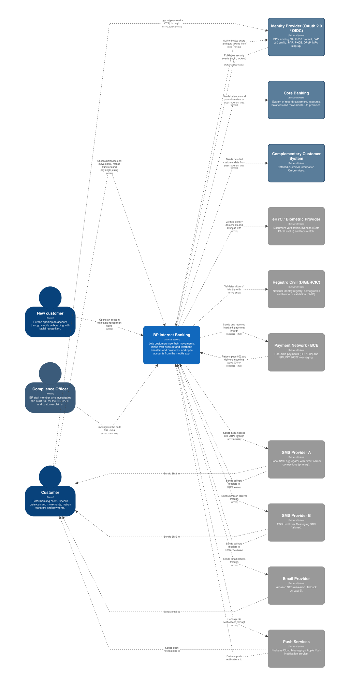

| Element | Role |
| --- | --- |
| Customer, New customer | Use the web and mobile apps; new customers onboard from the app |
| Operations & Compliance Staff | BP staff who review doubtful onboarding cases, resolve manual transfer cases and investigate the audit trail (Back-office Portal) |
| Core Banking, Complementary Customer System | BP on-premises systems of record (existing) |
| Identity Provider | BP's existing OAuth 2.0 / OIDC product |
| eKYC / Biometric Provider, Registro Civil | Identity verification during onboarding |
| Payment Network / BCE | Interbank real-time payments and SPI |
| SMS Providers A and B, Email Provider, Push Services | Notification channels |

### 4.3 Level 2: Containers

The full container view is in the repository ([02-Containers.svg](../architecture/.structurizr/1/images/02-Containers.svg)). For readability it is presented here as five focused views of the same model.

Figure 4.3a – Channels, edge, API Gateway and BFFs
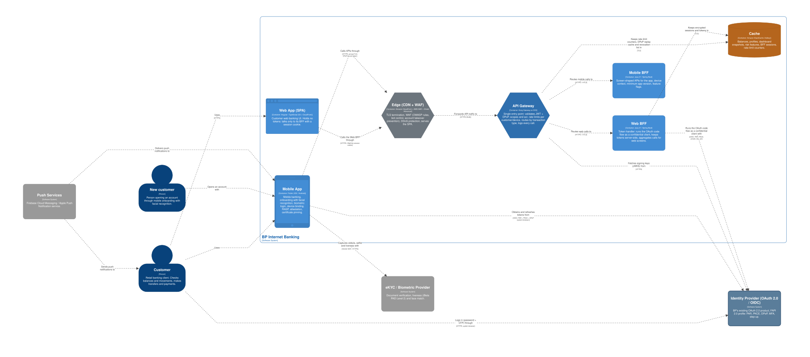

Figure 4.3b – Transfers and payments
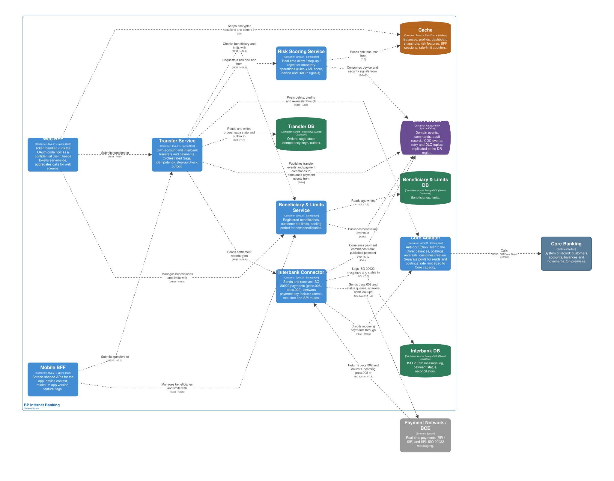

Figure 4.3c – Data access and frequent-client persistence
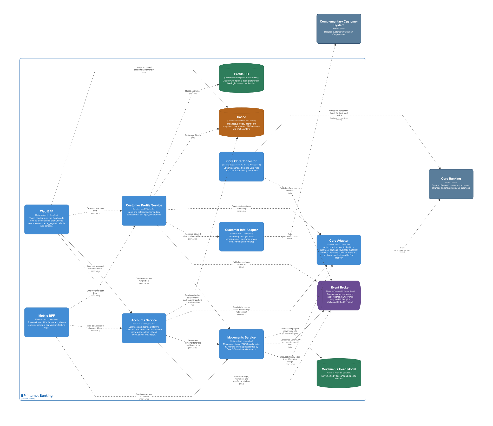

Figure 4.3d – Onboarding
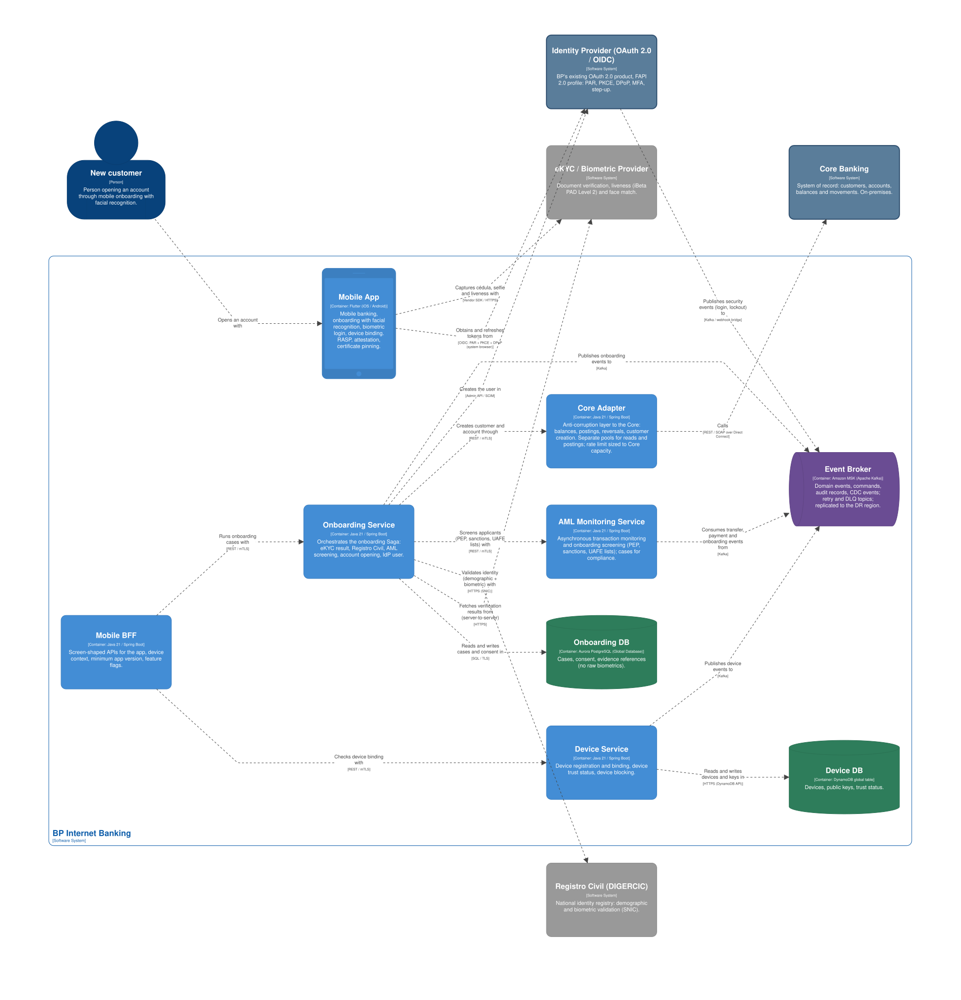

Figure 4.3e – Notifications and audit
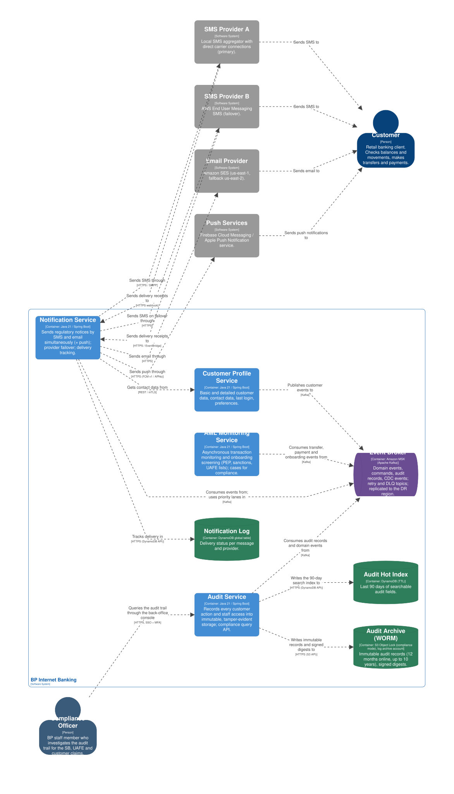

| Container | Technology | Responsibility |
| --- | --- | --- |
| Web App (SPA) | Angular, S3 + CloudFront | Web UI; holds no tokens |
| Mobile App | Flutter | Mobile UI, onboarding SDK, biometric login, device binding, RASP |
| Back-office Portal | Angular (internal) | Staff: manual onboarding review (four-eyes), manual transfer cases, audit queries; staff SSO + FIDO2 MFA |
| Edge | CloudFront + WAF + Shield Advanced | TLS, WAF, bot control, DDoS, SPA hosting |
| API Gateway | Kong on EKS | Single entry point: JWT + DPoP + acr checks, rate limits, routing, access log |
| Web BFF / Mobile BFF | Java 21 / Spring Boot | Token handler (web); screen-shaped APIs, device context, app version (mobile) |
| 14 domain services | Java 21 / Spring Boot on EKS | See section 4.1 |
| Core CDC Connector | Debezium on MSK Connect | Streams Core changes into Kafka |
| Event Broker | Amazon MSK (Kafka) | Events, commands, audit records, CDC; replicated to DR |
| Cache | ElastiCache (Valkey) | Balances, profiles, dashboards, risk features, sessions |
| Transactional DBs | Aurora PostgreSQL Global Database | Transfer, Beneficiary, Onboarding, Profile, Interbank |
| Key-value / read models | DynamoDB global tables | Movements read model, Device, Notification log, Audit hot index |
| Audit Archive | S3 Object Lock (compliance mode) | Immutable audit records |

### 4.4 Level 3: Components

Six containers are opened, chosen because they hold the patterns the statement asks about. Components are grouped in **layers** (API → business → integration and data). **Security boundaries** are the same in every view: (1) internet → gateway: TLS, WAF, JWT + DPoP; (2) gateway → service: mTLS on a private network, user identity forwarded in the token; (3) service → data and external systems: private endpoints, per-service IAM roles, no secrets in code, timeouts on every call.

Figure 4.4a – API Gateway: plugin chain (token, DPoP, acr checks before routing)
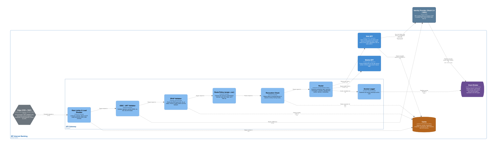
<em>How to read it.</em> Every request passes the plugins in order: rate limit, JWT, DPoP proof, route policy (scope and minimum `acr`), revocation list, then the router sends it to a BFF or, for staff routes, to the review, audit or operations APIs. The access logger publishes one audit record per call.

Figure 4.4b – Transfer Service: idempotency, step-up, Saga orchestrator, circuit-broken Core client, transactional outbox and inbox
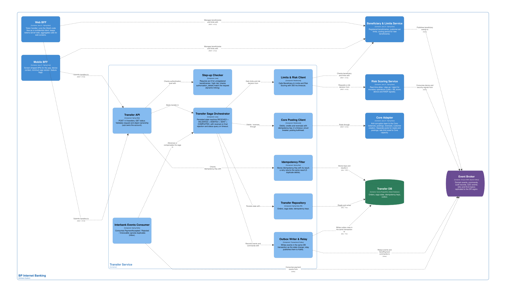
<em>How to read it.</em> Three layers. API: authorization (scope, ownership, step-up for new beneficiaries or high amounts) and idempotency; `202 Accepted` with a status URL for interbank transfers. Business: orchestrated Saga with a compensation handler and a reconciliation job against the Core and the interbank settlement reports; unresolved cases go to staff through the Operations Case API. Integration and data: repository with transactional outbox and circuit-broken clients to the Core Adapter, Limits and Risk.

Figure 4.4b′ – Onboarding Service: device attestation, signed vendor webhook, state machine, decision engine, four-eyes manual review
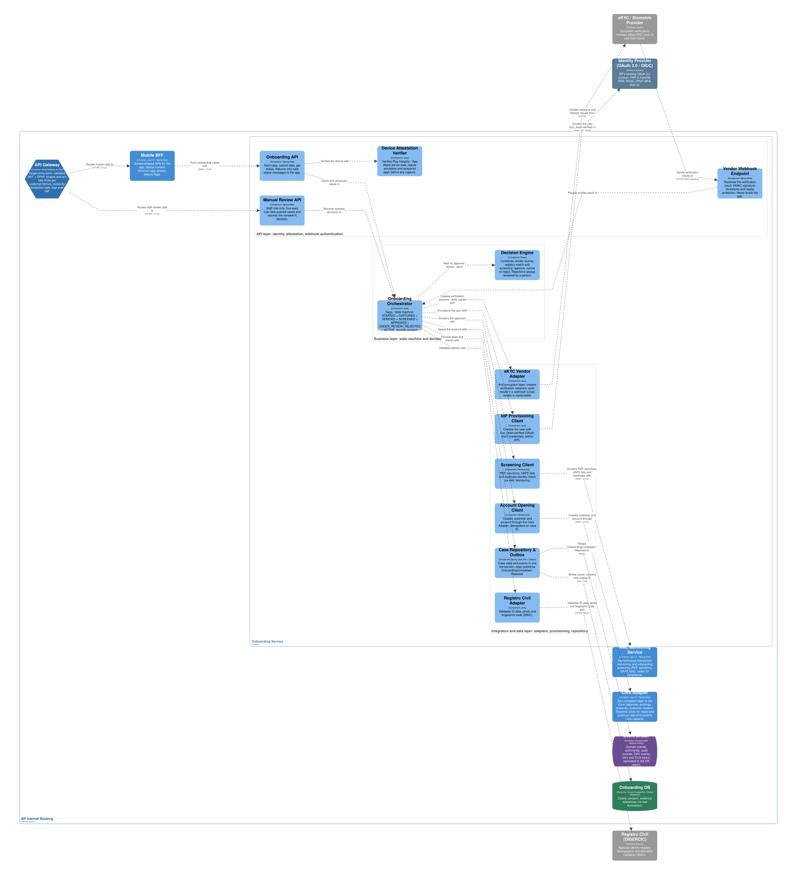
<em>How to read it.</em> The vendor's result is never taken from the app: it arrives through an **HMAC-signed webhook** (or is polled if the webhook is lost) and is combined with the Registro Civil match and the screening result. A state machine decides approve, review or reject; doubtful cases and all rejections go to the four-eyes review in the Back-office Portal. On approval the user is created in the identity product with `kyc_level=verified`. Device attestation blocks emulators and tampered apps before any capture.

Figure 4.4c – Accounts Service: frequent-client persistence (cache-aside, refresh-ahead, event-driven invalidation)
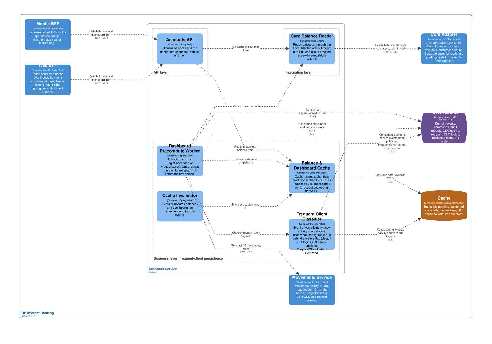
<em>How to read it.</em> The frequent-client classifier counts activity events in a sliding window and announces `FrequentClientAdded / Removed`; the precompute worker pre-builds the dashboard on that event and on each frequent client's login; the cache invalidator keeps balances fresh from movement events; reads go cache → read model → Core. The Core stays the source of truth: balances show their "as of" time and are re-checked by the Core before money moves.

Figure 4.4d – Notification Service: policy, templates, priority lanes, SMS failover, delivery tracking
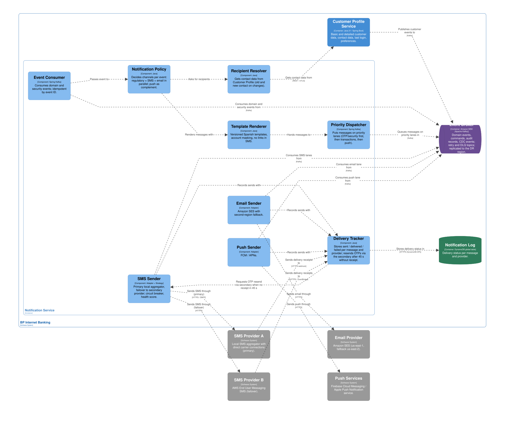
<em>How to read it.</em> Events come in once (idempotent consumer); the policy decides SMS + email in parallel for regulatory notices; messages are rendered with masking and queued on priority lanes; each provider sits behind an adapter with a circuit breaker; the tracker resends an OTP through the secondary SMS provider if no receipt arrives in 45 s.

Figure 4.4e – Audit Service: idempotent consumer, normalization, hash chain, WORM archive and hot index
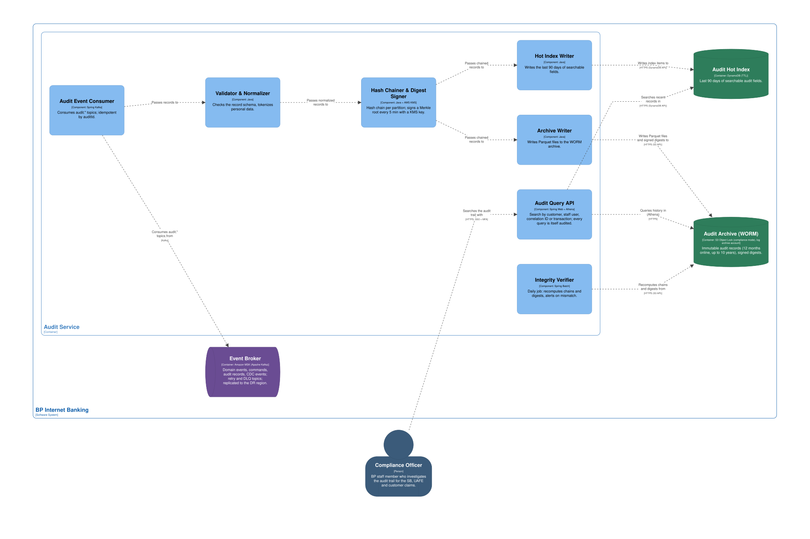
<em>How to read it.</em> Ingestion validates, tokenizes and hash-chains each record; storage writes the WORM archive and a 90-day search index; the query API is read-only and role-based (every query is itself audited); a daily verifier recomputes the chains and signed digests.

### 4.5 Infrastructure (deployment)

Figure 4.5 – Production on AWS: us-east-1 primary (3 AZs), us-east-2 warm standby, hybrid link to the Core
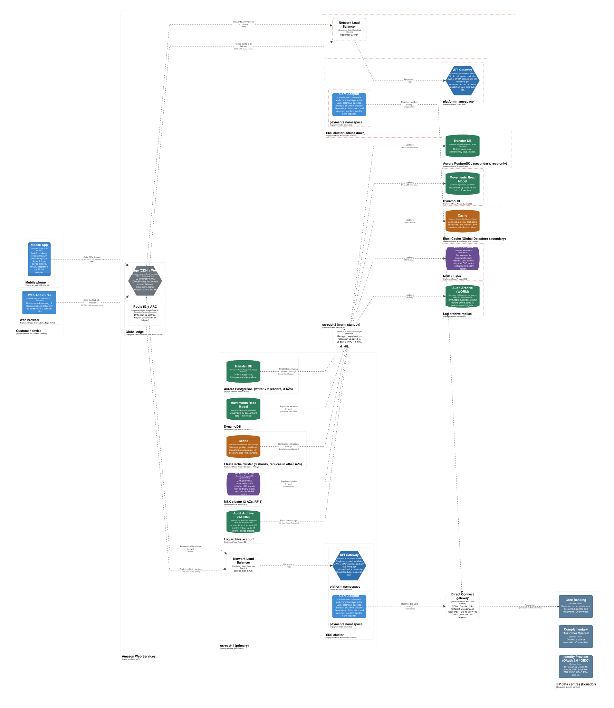

**Region choice and latency (ADR-002, ADR-003).** No AWS or Azure region exists in Ecuador, so the platform is hosted abroad under the SB cloud conditions. Round trips measured from Cuenca (8 Nov 2026): **us-east-1 ~90 ms**, us-east-2 ~103 ms, mx-central-1 ~118 ms, sa-east-1 ~157 ms (Ecuador's submarine cables route through Miami). Azure was not measured: its US East regions are in the same metros as AWS's, so similar numbers are expected; **Azure Chile Central** is the one unknown and should be measured before the decision is final (section 19). With HTTP/2 connection reuse, edge TLS termination and cache hits, a frequent client's dashboard stays well under 500 ms. Calls to the on-premises Core cross ~90 ms, which is why reads are served from caches and read models.

One representative element per platform service is shown; node descriptions list everything deployed there. EKS namespaces: **platform** (Kong, CDC), **channels** (BFFs), **payments** (Transfer, Beneficiary & Limits, Risk, Interbank, Core Adapter), **customer** (Accounts, Movements, Profile, Device, Onboarding, Customer Info Adapter), **support** (Notification, Audit, AML).

### 4.6 Sequence diagrams

Figure 4.6a – Web login (Authorization Code + PKCE + PAR via the Web BFF)
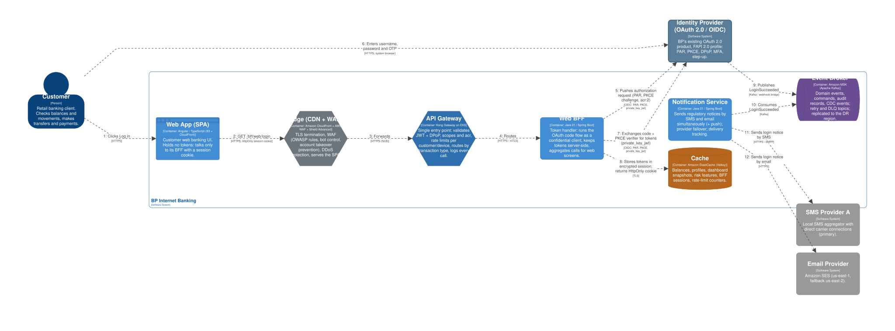

Figure 4.6b – Mobile biometric login with device-bound key and pre-built dashboard
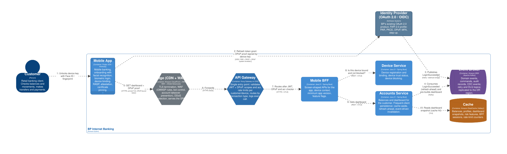

Figure 4.6c – Onboarding Saga with facial recognition
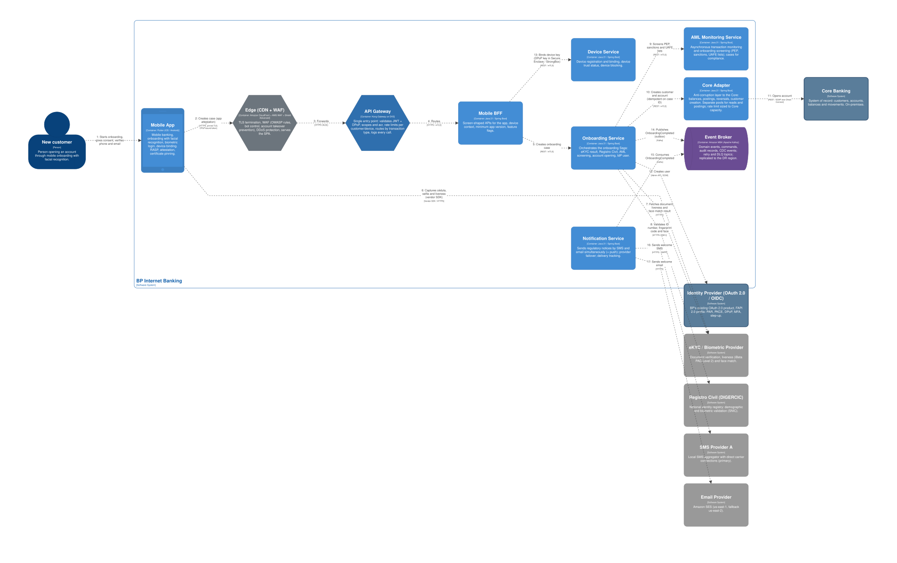

Figure 4.6d – Interbank real-time transfer (Saga, ISO 20022, notifications, audit)
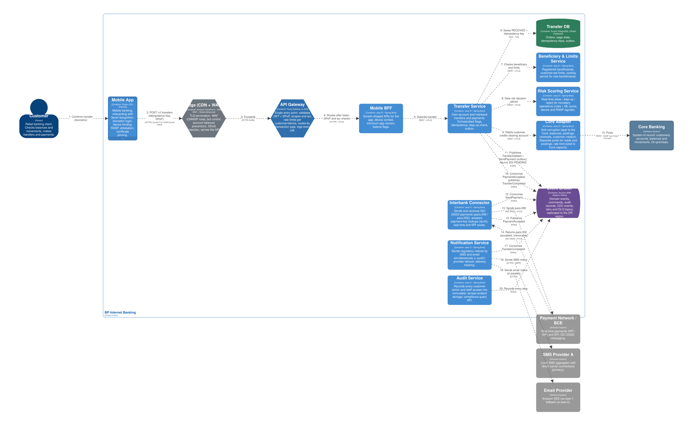

## 5. Front-end and mobile architecture

**ADR-005 – SPA: Angular** (weighted score 4.65 vs React 4.00, Vue 3.95). (1) Opinionated, complete framework (router, reactive forms, HTTP interceptors, DI): every team builds the forms-heavy banking UI the same way. (2) Secure by default: values are sanitized before reaching the DOM; strict CSP and Trusted Types are supported, reducing XSS, the main threat to a banking SPA. (3) Predictable releases with 18 months of support per major version.

**ADR-006 – Mobile: Flutter vs React Native → Flutter** (4.20 vs 4.00).

| Criterion (weight) | Flutter | React Native |
| --- | --- | --- |
| Tamper resistance, RASP / attestation (20%) | 5: AOT native code + obfuscation | 4: Hermes bytecode |
| Biometrics and secure hardware (15%) | 4 | 4 |
| Performance and UI consistency on low-end Android (15%) | 5: own rendering engine | 4: New Architecture closed much of the gap |
| Banking adoption (15%) | 4: Nubank | 4: Coinbase |
| Talent in Ecuador (15%) | 3 | 4 |
| KYC SDK availability (10%) | 4 | 4 |
| Ecosystem and backing (10%) | 4 | 4 |

Justifications: (1) stronger default protection of the binary, required by the SB anti-tampering rule and OWASP MASVS-RESILIENCE; (2) one rendering engine gives the same UI and accessibility behaviour on every device, fewer platform-specific defects; (3) proven at bank scale in Latin America (Nubank). Trade-off: smaller hiring pool.

**Design rules**

- **No tokens in the browser:** the Web BFF is a confidential OAuth client (token handler); the SPA receives only a `__Host-` HttpOnly, Secure, SameSite=Strict cookie (IETF *OAuth 2.0 for Browser-Based Apps*, BFF pattern). Strict CSP, Trusted Types, HSTS, anti-clickjacking headers.
- **One BFF per channel:** different security models (confidential web client vs native public client with DPoP) and release cycles.
- **Mobile security to OWASP MASVS L2 + R:** Keychain / Keystore with keys in **Secure Enclave / StrongBox**, **Play Integrity / App Attest** verified server-side, **commercial RASP** (root/jailbreak, hooking, emulator, overlay) feeding Risk Scoring, certificate **public-key pinning**, obfuscation, screenshot blocking on sensitive screens, forced update.
- **Micro-frontends rejected:** web is ~10% of traffic with few teams; one modular SPA (Nx, lazy-loaded features) instead, revisited above ~3 parallel web teams.
- Encrypted last-known dashboard on the device shown instantly "as of hh:mm"; idempotency key per transfer attempt; WCAG 2.2 AA; staged store rollouts and server-side feature flags.

## 6. Authentication and authorization

**ADR-007 – Recommended flow: OAuth 2.0 Authorization Code + PKCE + PAR, FAPI 2.0 Security Profile, sender-constrained tokens.** Implicit and Resource Owner Password grants are deprecated (RFC 9700) and disabled.

| Channel | Client | Client authentication | Token binding | Token storage |
| --- | --- | --- | --- | --- |
| Web | **Web BFF, confidential** | `private_key_jwt` | mTLS / DPoP from the BFF | Server-side session store only |
| Mobile | Public client, system browser (RFC 8252) + app attestation | PKCE + attestation | **DPoP** with a non-exportable key in secure hardware | Keychain / Keystore |

Justifications: (1) **meets QAS-10** – a stolen token can't be replayed without the device key, lives 5 minutes, and can't move money without step-up; (2) **one security model for both channels**, validated identically at the gateway and reusable by new channels; (3) **FAPI is the international open-banking profile** (UK, Brazil, Australia), recognisable evidence for the SB; (4) **biometrics never leave the device**, so login doesn't process biometric data under the LOPDP.

**Login methods after onboarding**

| Method | Factors | Use |
| --- | --- | --- |
| Username + password + **OTP** | Knowledge + possession | Web and mobile; always available (non-biometric alternative). OTP preference: **in-app confirmation or app TOTP**, **SMS only as fallback** (SIM-swap risk) |
| **Biometric login** (Face ID / fingerprint) | Possession (device key) + inherence (biometric unlocks it) | Mobile; the key signs the DPoP proof of the refresh-token grant |
| Passkeys (FIDO2) | Possession + inherence | Optional for web; **not** used as the mobile factor because synced passkeys break "authorized devices only" |

**Step-up with dynamic linking:** transfers to unregistered accounts, new beneficiaries, limit increases, contact changes and device registration require `acr:3`. The API answers `insufficient_user_authentication` (RFC 9470); the app re-authorizes with `authorization_details` (RFC 9396) containing amount and beneficiary; the resulting 2-minute, single-use token is valid only for that transaction. Web customers can approve in the mobile app (decoupled, CIBA).

| Customer action | Required assurance |
| --- | --- |
| View balances and movements; own-account transfer | `acr:2`: device key + biometrics (mobile) or password + OTP (web) |
| Transfer to a registered beneficiary under the threshold | `acr:2` |
| Amount over the threshold or new beneficiary | `acr:3`: fresh confirmation bound to the transaction (in-app biometric signature or TOTP) + cooling period for new beneficiaries |
| Change device, password or contact; account recovery | Password + OTP **and** facial re-verification with liveness (+ Registro Civil); notice to old and new contacts |

**Rules from the SB:** lockout after 3 failures with immediate SMS + email; login notification; idle timeout (web 5 min); last-login date shown; old and new contacts notified on change; 24/7 device blocking.

**Tokens:** access 5 min (JWT, PS256/ES256 keys in KMS/HSM); refresh tokens rotated with reuse detection; ID token never sent to APIs.

**Authorization:** the **gateway** validates signature (cached JWKS), `iss/aud/exp`, the **DPoP proof** (htm, htu, jti replay, `cnf.jkt`), scopes and minimum `acr` per route, plus a revocation list on money-moving routes; **services** enforce object-level authorization (the account belongs to `sub`, OWASP API1) and limits; service-to-service traffic uses **mTLS** (Istio ambient).

The bank's identity product must support PAR, PKCE, `private_key_jwt`, DPoP, refresh rotation, `acr` / RAR, MFA, lockout events and JWKS; Keycloak, Ping/ForgeRock and Okta/Auth0 are candidate products with this feature set.

## 7. Onboarding with facial recognition

**Checks:** cédula document authenticity → **liveness** (iBeta PAD Level 2, ISO/IEC 30107-3) and injection-attack detection → **1:1 face match** with the document → **Registro Civil (DIGERCIC SNIC)** demographic + biometric validation (USD 0.30 per query) → age ≥ 18 → **PEP / sanctions / UAFE screening** → phone and email OTP → explicit **consent**.

**ADR-008 – Buy a specialist eKYC platform** instead of building on AWS Rekognition (which offers liveness but no cédula document verification or registry connector). Shortlist and PoC: **FacePhi** (preferred: documented Registro Civil Ecuador validation, Latin American banking track record) and **Jumio** (alternative: Ecuador registry check); iProov, Veridas, FaceTec, Onfido also evaluated. Justifications: (1) only specialist vendors cover document + registry + liveness together; (2) independently tested liveness and injection-attack defence give auditable evidence for QAS-11; (3) an anti-corruption layer keeps the vendor swappable. The bank holds the DIGERCIC contract itself as data controller and obligated KYC party.

**Saga (orchestrated by the Onboarding Service)**

| Step | On failure |
| --- | --- |
| Consent, age, contact OTP | Stop; abandoned case deleted after 7 days |
| Document + liveness + face match (vendor SDK, results fetched server-to-server) | 3 retries, then **assisted / branch onboarding** |
| Registro Civil validation | Registry down → pending + retry; mismatch → manual review |
| AML screening | Hit → **manual review** (never auto-reject) |
| Create customer and account in the Core (idempotent on case ID) | Retry; pending + alert |
| Create user in the IdP | Retry; account blocked until the user exists (no compensation) |
| Device binding + biometric login enrolment | Repeatable at next login |
| `OnboardingCompleted` via outbox | Audit, Notification, AML, Profile |

**Components (Figure 4.4b′):** device attestation verified server-side before capture; **HMAC-signed vendor webhook** with replay protection (polling fallback); state machine `STARTED → CAPTURED → VERIFIED → SCREENED → APPROVED | UNDER_REVIEW | REJECTED → ACTIVE`; decision engine; **four-eyes manual review** in the Back-office Portal; IdP provisioning with `kyc_level=verified`; case repository with outbox.

**Hand-off to authentication:** the customer sets a password, the app generates the DPoP key in secure hardware and registers it with the Device Service (`acr:3` operation, notified by SMS + email), and biometric login is enrolled.

**Biometric data:** raw selfies and document images are deleted after the decision; **no face template is stored** (login uses on-device biometrics; recovery repeats liveness + registry); evidence (vendor transaction ID, scores, decision, reviewer) and the consent record go to the WORM audit store. DPIA before go-live and every 12 months; rejections reviewed by a person; no minors.

## 8. Integration layer and communication patterns

**Interbank payments (Res. BCE-GG-007-2026):** ISO 20022 **`pacs.008`** payment order, **`pacs.002`** accept / reject / irrevocability, **`acmt`** payment-key lookups; the ordering bank **debits first**, then sends; accepted payments are **irrevocable**; intra-network messaging due by **30 Nov 2026**. The Interbank Connector is two-way: it also **receives** incoming `pacs.008` (credit + `pacs.002` within the network timeout, a T1 path) and answers key lookups. Real-time route up to the cap, SPI route above it.

| Decision | Choice | Main alternatives | Justifications |
| --- | --- | --- | --- |
| **ADR-009 API Gateway** | **Kong on EKS** (4.50) | Apigee 3.55, Amazon API Gateway 3.55, Azure APIM 2.70 | DPoP / FAPI checks as plugins (AWS API Gateway would need a Lambda authorizer per call); flat cost at billions of requests; declarative, portable config in Git, identical in both regions |
| **ADR-010 Messaging** | **Amazon MSK (Kafka)** (4.70) | Confluent Cloud 4.55, SQS/SNS/EventBridge 3.15 | Replay to rebuild read models and audit; per-account ordering; one backbone for events and CDC; data stays in the bank's account |
| **ADR-011 Compute** | **Amazon EKS** (4.80) + Lambda only for glue | ECS Fargate 3.65, Lambda 2.65 | Portability and one platform for gateway, mesh and services; auto-healing and Karpenter/KEDA elasticity; steady low-latency load with long-lived Core and Kafka connections |

**Communication:** REST/JSON (OpenAPI 3.1) for synchronous calls; Kafka for events and commands; gRPC deferred. **Service stack:** Java 21 + Spring Boot 3 (virtual threads, Resilience4j, OpenTelemetry). **Service mesh:** Istio ambient mode for mTLS and authorization policies; retries configured in one place only.

**Patterns**

| Pattern | Where | Attribute |
| --- | --- | --- |
| Timeout, retry with backoff + jitter (idempotent calls only) | All outbound calls | QAS-03 |
| **Circuit breaker** | Core, complementary system, providers, eKYC, Registro Civil | QAS-03 / 04 |
| **Bulkhead** | Core Adapter: separate pools for reads and postings | QAS-03 / 09 |
| Rate limiting toward the Core | Token bucket sized to Core capacity | QAS-03 |
| **Idempotency key** | Every money-moving request | QAS-05 |
| **Transactional outbox** + **idempotent consumer (inbox)** | All event producers / consumers | Consistency, no lost audit events |
| **Saga (orchestrated)** | Transfers, onboarding | Consistency without 2PC |
| **Anti-corruption layer** | Core, complementary system, BCE network, eKYC | Decoupling |
| API composition / **BFF** | Screen aggregation | QAS-06 |
| Strangler fig | Gateway routing during migration | Migration risk |
| Load shedding | Gateway sheds history exports before transfers | QAS-09 |

**Interbank transfer Saga:** `RECEIVED → VALIDATED → DEBITED → SENT → COMPLETED`; a final `pacs.002` rejection triggers a **reversal** (credit back); a timeout means **UNKNOWN** and a status query, never a blind reversal of a possibly irrevocable payment. The customer gets `202 Accepted` with a status URL in < 3 s (QAS-08) and the final status asynchronously (FR-13). A **compensation handler** reverses debits on final rejection or expiry; a **reconciliation job** compares transfers with Core postings and interbank settlement reports; anything unresolved becomes a **manual operations case** for staff in the Back-office Portal.

## 9. Data access and frequent-client persistence

**Principles:** the Core is the system of record; cloud copies are read models; database per service; reads from the closest copy, writes to the owner; minimal personal data in caches and events.

**ADR-012 – Data stores:** Aurora PostgreSQL Global Database for transactional services (outbox + idempotency in one ACID transaction), **DynamoDB global tables** for high-volume key-value data and read models (movements ~4 B items, constant latency), **ElastiCache (Valkey)** for caching; only three data technologies. Justifications: right store per access pattern; managed cross-region replication meeting RPO 1 min; small technology set.

**ADR-013 – Frequent-client persistence (statement §3.6).** An **event-driven classifier** keeps a sliding-window activity score per customer and applies a configurable rule behind a feature flag (default ≥ 4 logins in 30 days), publishing `FrequentClientAdded / Removed`. Four patterns work together:

| Pattern | Applied to | Effect |
| --- | --- | --- |
| **CQRS read model** | Movements (DynamoDB, 13 months) fed by Core CDC + transfer events | History queries never touch the Core |
| **Cache-aside** | Balances (TTL 60 s), profiles (24 h), dashboard snapshot (5 min) | Most reads served from memory |
| **Event-driven invalidation** | Movement, transfer and incoming-payment events evict keys in seconds | No stale balances |
| **Refresh-ahead + materialized view** | On `LoginSucceeded` of a frequent client, a worker pre-builds the dashboard | First screen is a cache hit |
| Request coalescing, jittered TTL, stale-while-revalidate | All caches | No thundering herd; "as of hh:mm" fallback when the Core is down |

Rejected: calling the Core every time (latency, Core load, no fault tolerance), cache-aside only (cold starts on payday), full Core replica (duplicates the system of record), device-only cache (not for web or new devices). Justifications: (1) meets QAS-06 and protects the Core even on payday; (2) each pattern covers another's weakness; (3) fault tolerance as a side effect, exactly the failure mode of the 2025 outages. A cached balance is **displayed only**; the Core checks the available balance when posting.

**ADR-014 – Core CDC:** log-based CDC with **Debezium** on a **Core read replica** (seconds of freshness, no Core code change, negligible load); nightly reconciliation; fallback: incremental polling for active customers only.

**Data protection:** KMS customer-managed keys per domain (crypto-shredding), TLS everywhere, application-level encryption of cédula, phone, email; tokenized identifiers in events and logs; masking; least-privilege IAM per service; synthetic or masked data outside production.

## 10. Audit solution

**What is audited:** every customer action including reads, security events, onboarding evidence and consent, **staff access to customer data**, and (separately) platform admin actions via CloudTrail. The record schema covers the SB minimum: date, time, amount, origin and destination accounts and banks, transaction number, notified phone and email, OTP channel, IP, device, correlation ID.

**ADR-015 – Audit architecture.** Capture: domain events via **transactional outbox**, gateway access records (Kong kafka-log), an `@Audited` **interceptor** for reads and back-office access, IdP security events → Kafka `audit.*` → **Audit Service** (validate, tokenize, **hash-chain**) → **S3 Object Lock in compliance mode** in the separate log-archive account (Parquet, queried with Athena) + **DynamoDB hot index** (90 days) → compliance console (every query itself audited, case number mandatory).

| Storage option | Verdict |
| --- | --- |
| **S3 Object Lock (compliance)** | Chosen: nobody, not even root, can delete before retention ends; assessed for SEC 17a-4 |
| DynamoDB | Hot index only (mutable) |
| OpenSearch | Not needed; costly at this volume, mutable |
| Aurora + pgAudit | Rejected: a DBA can change rows |
| **Amazon QLDB** | **Retired (end of support 31 Jul 2025)** |

Justifications: (1) real immutability against insiders (QAS-12); (2) no event lost (outbox) and the critical path is never blocked (asynchronous, T2 service catches up from Kafka); (3) 10 years affordable (Parquet + Glacier Deep Archive); (4) **tamper evidence** on top: hash chain per partition, Merkle-root digest signed with KMS every 5 minutes, daily verification job, write-only cross-account access, SCPs that forbid disabling the lock. Full Event Sourcing was rejected as too complex for every service; outbox + pub/sub + append-only log gives the audit trail.

**Retention:** 12 months online (SB), 10 years archive for transaction and KYC/AML records, legal hold for claims. ~86 M records/day ≈ 3.2 TB/year compressed.

## 11. Notifications

**ADR-016:** the two regulatory notification systems are **SMS and email, sent in parallel** for every monetary transaction and login; push and an in-app inbox complement them.

| Channel | Primary | Failover |
| --- | --- | --- |
| SMS | **Local aggregator** with direct Claro / Movistar / CNT connections | **AWS End User Messaging SMS** |
| Email | **Amazon SES** us-east-1 | SES us-east-2 |
| Push | FCM / APNs | — |

Justifications: (1) two independent systems for every regulatory notice; (2) SMS carries OTPs, so it has two providers with automatic failover (QAS-04, SB alternate-provider rule); (3) local aggregators give better price and delivery in Ecuador; (4) no retired services: **Amazon Pinpoint reached end of support on 30 Oct 2026**, only its continuing messaging APIs are used.

Design: event consumer → policy → recipient resolver → template renderer (masking, no links in SMS) → **priority lanes** (OTP/security before transactions) → senders with **adapter + strategy**, circuit breakers → delivery tracker with receipts; an OTP without delivery receipt in 45 s is resent through the secondary. SPF, DKIM, DMARC `p=reject` on the sending domain. Regulatory notices can't be switched off by the customer.

## 12. Security architecture

Principles: **Zero Trust** (NIST SP 800-207), defence in depth, least privilege, secure by default, assume breach.

| Layer | Controls |
| --- | --- |
| Client | MASVS L2 + R, RASP, attestation, pinning, secure-hardware keys; BFF token handler, CSP |
| Edge | CloudFront only entry; **AWS WAF** managed rules, Bot Control, **Account Takeover Prevention**; **Shield Advanced** |
| API | Kong: JWT + DPoP, scopes, acr, rate limits per customer/device, schema validation |
| Identity | FAPI 2.0, 2-of-3 factors, step-up with dynamic linking, device binding, lockout; staff SSO with FIDO2 MFA |
| Service | Istio mTLS + authorization policies, object-level authorization, Risk Scoring before money moves |
| Network | Private subnets, VPC endpoints, **Network Firewall egress allowlist**, encrypted Direct Connect, deny-by-default NetworkPolicies |
| Data | KMS per domain, **CloudHSM** for HSM-bound keys (OTP seeds, network signing), field-level encryption, tokenization, Macie |
| Detection | CloudTrail, GuardDuty (EKS runtime), Security Hub, Inspector, **Security Lake → bank SIEM / 24×7 SOC** |
| Supply chain | SAST, SCA + SBOM, IaC policy checks, signed images (cosign) + admission control (Kyverno), DAST, annual pentest |

**Fraud:** Risk Scoring returns allow / step-up / reject in ≤ 300 ms using device, RASP, behaviour, velocity and beneficiary signals (rules + ML score); cooling-period limits for new beneficiaries; beneficiary name shown from the `acmt` lookup; AML Monitoring watches mule patterns. The OWASP API Security Top 10 (2023) is mapped control by control in the step notes.

**ADR-017 – Security tooling:** AWS-native security services forwarding to the bank's existing SIEM through Security Lake (OCSF). Justifications: native coverage without agents; one SOC for cloud, Core and channels (supports SB incident deadlines); continuous compliance evidence for annual audits.

## 13. High availability, fault tolerance, DR and auto-healing

| Tier | Services | Availability | RTO / RPO |
| --- | --- | --- | --- |
| T1 | Edge, gateway, BFFs, Device, Accounts, Movements, Transfer, Beneficiary & Limits, Risk, Core Adapter, Interbank, Profile | 99.99% | 15 min / 1 min |
| T2 | Onboarding, Notification, Audit, Customer Info Adapter | 99.95% | 1 h (Notification 15 min) / ~0 (events kept) |
| T3 | AML, reporting, batch | 99.9% | 4 h / 1 h |

**Multi-AZ HA:** ≥ 3 replicas per T1 service with topology spread and N+1 capacity; Aurora failover < 30 s; Kafka RF 3 / `min.insync.replicas=2`; ElastiCache Multi-AZ; **ARC zonal autoshift** away from impaired AZs.

**ADR-018 – DR: warm standby (T1) in us-east-2**, pilot light (rest of T2), backup & restore (T3). Failover is **decided by a person and executed by ARC Region switch plans** (Aurora Global Database failover and scaling, EKS scaling, routing): ≈ 12–15 min. Justifications: (1) meets RTO 15 min / RPO 1 min at ~12–15% extra cost, versus roughly double for active/active; (2) transfers need a single writer and the Core is a single site, so active/active adds conflict handling on money for little gain; (3) a different region satisfies the SB's remote-site rule and is drilled twice a year; (4) human-started, machine-executed failover avoids flapping. In-flight sagas resume from Aurora state, reconciled with the Core; failback is a planned zero-loss switchover.

**Auto-healing:** liveness/readiness probes (liveness never checks dependencies), Karpenter node replacement, HPA/KEDA scaling, **canary releases with automatic rollback**, GitOps drift correction, circuit breakers that close on recovery.

**Graceful degradation:** Core down → balances and movements "as of hh:mm", transfers rejected clearly; payment network down → interbank rejected before debit; one SMS provider down → failover; Notification or Audit down → events wait in Kafka; Risk Scoring down → fail closed for risky transfers.

**Backups** isolated from replication (ransomware): PITR 35 days, AWS Backup with **Vault Lock** in a separate account; quarterly restore tests. **Testing:** AWS FIS chaos experiments monthly (staging) and quarterly game days, AZ failure simulation, **full regional failover twice a year**, 3× load tests before payday seasons.

## 14. Monitoring and observability

**ADR-019 – OpenTelemetry everywhere** (ADOT collectors) → Amazon Managed Prometheus (metrics), X-Ray / Application Signals via OTLP (traces), CloudWatch Logs (logs), **Amazon Managed Grafana** (dashboards and alerts); security events → Security Lake → SIEM. Scores: AWS-managed open-source stack 4.25, self-hosted Grafana 4.10, Datadog 3.60, Dynatrace 3.50. Justifications: vendor-neutral instrumentation (and AWS's path now that the **X-Ray SDKs reach end of support on 25 Feb 2027**); telemetry stays in the bank's account (LOPDP); cost follows usage.

- **Correlation ID = trace ID**, propagated through HTTP **and Kafka headers**, logged, stored in audit records and returned to the app for support (QAS-13).
- **SLOs** per journey (login 99.95%, dashboard 99.99% available / 99.9% < 500 ms, transfers, **incoming payments answered within the network timeout 99.99%**, notifications < 60 s) with **error budgets** that pause releases when exhausted.
- **Burn-rate alerting** (multi-window) every minute → PagerDuty; Opsgenie (end of support Apr 2027) and AWS Incident Manager (closed to new customers) avoided.
- **Business dashboards:** transfers per minute vs last week, pending/unknown interbank age, onboarding funnel, notification delivery and cost per provider, Core latency and CDC lag, cache hit ratio, DR replication lag.
- Synthetic journeys every minute from outside AWS (ideally from Ecuador); real-user monitoring and crash reporting; no personal data in telemetry (redaction in the collector), tail sampling.

## 15. Operational excellence

- **ADR-020 – Terraform** (or the open-source fork **OpenTofu**): one tool for AWS and non-AWS resources (Kong, Grafana, PagerDuty, GitHub), plan-before-apply as change evidence, portable skills.
- **Environments:** dev (ephemeral PR environments), QA (vendor sandboxes), staging (production-like: performance, chaos, DR rehearsal, pentest), production in two regions; same image digest promoted; real data never leaves production.
- **Pipeline:** build → tests → SAST, secret scan → SCA + SBOM → contract tests (OpenAPI, Kafka schemas) → image scan and signing → GitOps (Argo CD) → **canary 5% → 25% → 50% → 100% with automatic rollback** on SLO breach; mobile via Fastlane with staged store rollouts; feature flags (OpenFeature / AppConfig) and kill switches; expand/contract database migrations; release freezes around payday.
- **Change management:** bank CAB kept, with **pre-approved standard changes** when the pipeline proves its controls; evidence stored automatically for auditors and the SB.
- Runbooks per alert, incident process with SB/SPDP deadlines, blameless post-incident reviews, operational readiness reviews, DORA metrics, stream-aligned teams plus platform, security and SRE teams, and a **golden-path service template**.

## 16. Cost management

Monthly estimate at full scale. **Unit prices were checked on 8 Nov 2026 against the public AWS Price List** (us-east-1 on-demand; CloudFront South America); quantities are the sizing assumptions. **Notification volume:** ~225 M notices a month, each sent by SMS **and** email: ~164 M monetary transactions plus ~60 M login notices (about one per daily active user per day; the SB requires a notice on every e-banking login, and the same two channels are used as for money movements). Status: Verified = unit price from the Price List; Partial = unit price verified, part of the volume estimated; Estimated = needs a quote. Line-by-line detail and how to reproduce each query: `roadmap-steps/16b-cost-validation.md`.

| Area | Key unit prices (Price List) | USD / month | Status |
| --- | --- | --- | --- |
| Compute: EKS (2 clusters) + ~65 m7g.xlarge nodes, Savings Plan on baseline | 0.10 / cluster-h; 0.1632 / node-h | ≈ 6,850 | Verified |
| Aurora PostgreSQL: 5 clusters + Global Database secondaries, storage, I/O | 1.106 / h (r7g.2xlarge), 0.276 / h (r7g.large), 0.10 / GB-mo | ≈ 6,150 | Verified / Partial |
| DynamoDB: read model, device, notification log, audit index (global tables), PITR | 0.625 / M writes, 0.125 / M reads, 0.25 / GB-mo | ≈ 8,100 | Partial |
| ElastiCache Valkey: 9 × r7g.xlarge | 0.3496 / node-h | ≈ 2,300 | Verified |
| MSK: 9 × kafka.m7g.xlarge, storage, Replicator | 0.408 / broker-h, 0.10 / GB-mo | ≈ 4,100 | Partial |
| Networking: 2 × 10G Direct Connect, Network Firewall, NAT / TGW / endpoints | 2.25 / port-h; 0.395 / endpoint-h + 0.065 / GB | ≈ 7,800 | Verified / Estimated |
| Edge: CloudFront (South America), WAF, Bot Control, Fraud Control (ATP) on ~5 M password logins, Shield Advanced | 0.022 / 10k HTTPS req, 0.110 / GB; 0.60 / M req; 10 / M; 1.00 / 1,000 logins; 3,000 / mo | ≈ 18,200 | Verified / Partial |
| Security: CloudHSM (4 HSMs) + GuardDuty, Security Hub, Inspector, Macie, Security Lake, KMS | 1.60 / HSM-h | ≈ 9,700 | Verified / Estimated |
| Observability | Usage-based | ≈ 10,000 | Estimated |
| Storage and backup | Usage-based | ≈ 1,500 | Estimated |
| Email: Amazon SES, ~225 M (transactions + logins) | 0.10 / 1,000 | ≈ 22,500 | Verified |
| **Production** | | **≈ 97,000** (> 60% from verified unit prices) | |
| Non-production (scheduled shutdown) | | ≈ 20,000–25,000 | Estimated |
| **AWS total** | | **≈ 117,000–122,000 (≈ USD 1.43 M / year)** | |

Carrier circuits from Ecuador to the Direct Connect location are not in the AWS bill and need a quote. The biggest single lever found while checking prices: keeping the **audit hot index in one region** (rebuilt from the S3 archive after a failover) and on the Standard-IA table class saves ≈ USD 3 k a month.

**Outside AWS:** SMS ≈ **USD 1.1–4.5 M / month** for ~225 M messages at USD 0.005–0.02 each, depending on the negotiated price (9–38× the whole AWS bill; login notices alone are ≈ USD 0.3–1.2 M of it; Registro Civil USD 0.30 per check is verified on gob.ec), Registro Civil ~USD 15 k, eKYC vendor and licences by quote. **DR cost:** warm standby ≈ USD 10–12 k / month vs ≈ USD 50–60 k for active/active.

**ADR-021 – Cost optimization:** commit to the steady baseline (Savings Plans, reserved instances), scale everything above it automatically, run on **Graviton**, and manage cost with **FinOps** (mandatory tags checked in the pipeline, budgets and anomaly detection, cost per user / transaction / SMS, monthly reviews). Justifications: a clear baseline with predictable peaks; better price-performance on ARM; cost made visible to each team. Main levers: SMS price negotiation and push where the SB allows it, non-production shutdown, Spot for CI and batch, WAF bot/ATP scoped to login, log classes and tail sampling, S3 lifecycle for audit.

## 17. Delivery plan and evolution

The architecture above is the **target**. It is reached in **four stages**; each stage must prove something before the next one is paid for, so spend and risk grow with demonstrated demand (ADR-022).

| Stage | Technique | Scope | AWS cost (USD / month) |
| --- | --- | --- | --- |
| **1. Pretotype** | Pretotyping: *Fake Door* (a "Transfers" button that measures intent and answers "coming soon"), *Pinocchio* (navigable app), *Mechanical Turk* (staff review onboarding by hand) | App and SPA through the gateway to **mock endpoints generated from the OpenAPI contracts**; eKYC vendor sandbox; feature flags and analytics. **No Core, no real data** | 1,000–2,000 |
| **2. Read-only MVP** | Real value, low risk | Profile, Accounts, Movements with **hexagonal architecture**; real Core and identity integration; biometric login; basic audit; one region, multi-AZ; pilot cohort | 15,000–25,000 |
| **3. Transactional** | Iterative expansion: own-account first, then interbank, by cohort behind flags | Transfer Saga, idempotency, outbox, Limits, Risk, Notifications (SMS + email), full Audit, Kafka, real onboarding, step-up; **warm standby DR before transfers open beyond the pilot** | 60,000–80,000 (+ SMS) |
| **4. Enterprise scale** | Hardening driven by measured load and the regulator | Full multi-region with ARC, frequent-client refresh-ahead at scale, Shield Advanced, CloudHSM, chaos and DR drills, push to reduce SMS | 117,000–122,000 (+ SMS) |

**Go / no-go gates** (falsifiable hypotheses "at least X% of Y will do Z"; thresholds to agree with Product):

| Gate | Hypothesis | If it fails |
| --- | --- | --- |
| End of stage 1 | ≥ 70% of pilot users complete login and onboarding unaided; ≥ 25% tap "Transfers" within two weeks | Change the flow or features; don't build the integration yet |
| End of stage 2 | ≥ 40% of the pilot checks balance or movements weekly; read p95 within target; no Sev-1 in four weeks | Fix experience or performance before adding features |
| End of stage 3 | ≥ 15% of active users complete a transfer in the first month; success ≥ 99.5%; notification delivery ≥ 99% | Keep transfers behind the flag and fix reliability |
| End of stage 4 | SLOs met two months in a row; regional DR drill within RTO / RPO | Keep hardening before broad launch |

**Minimum resilience line.** Stage 1 holds no real data. Stage 2 requires multi-AZ, backups with tested restore and everything as code. Before transfers open beyond the pilot (stage 3): warm standby DR and a first drill, or a risk acceptance signed by Risk and Compliance; regulatory notifications live from the first real transfer.

| Technical debt accepted | Paid back when |
| --- | --- |
| Mock endpoints (stage 1) | Stage 2 replaces and deletes them |
| In-process event publisher (stage 2) | Stage 3 plugs Kafka in behind the same port |
| Single region with restore-based recovery (stage 2) | Warm standby before transfers scale |
| No refresh-ahead / classifier until stage 4 | Measurements show Core latency or payday load hurting the dashboard SLO |
| No push channel | SMS cost justifies it and the SB accepts push |

Contracts first (OpenAPI, Kafka schemas), routing by path or cohort at the gateway and hexagonal adapters make a mock and a real service interchangeable without rewriting the apps. A fake-door test in a bank must be honest and reviewed by Legal and Compliance.

## 18. Architecture decision log

Every ADR records its context, the alternatives evaluated, the decision and at least two justifications; the full text is in the repository step notes ([roadmap-steps/](../roadmap-steps/)).

| ADR | Decision | Alternatives evaluated | Justifications (summary) |
| --- | --- | --- | --- |
| 001 | Structurizr DSL for C4 | draw.io, C4-PlantUML, IcePanel | One model → consistent views; diagrams as code in Git; context, container, component, deployment and dynamic views in one tool |
| 002 | AWS | Azure | Lowest latency among the AWS regions measured (~90 ms us-east-1; Azure Chile Central not yet measured); managed multi-region data services for RPO/RTO; Financial Services Lens |
| 003 | us-east-1 primary, us-east-2 DR | São Paulo; us-east-1 + sa-east-1; single region | Latency; DR region with separate risks (SB) and acceptable latency (~103 ms) |
| 004 | Microservices by bounded context (coarse-grained) | Modular monolith; fine-grained microservices | Independent scaling of reads and payday transfers; fault isolation; data boundaries per compliance rules; reuse |
| 005 | Angular SPA | React, Vue | Complete opinionated framework; secure by default; predictable support |
| 006 | Flutter | React Native | Tamper resistance; consistent UI on low-end devices; proven in LATAM banking |
| 007 | Code + PKCE + PAR, FAPI 2.0, DPoP, BFF token handler; in-app / TOTP second factor, SMS OTP as fallback | ROPC, Implicit, tokens in browser storage, synced passkeys on mobile, SMS-only OTP (SIM swap) | Stolen-token resistance; one model for both channels; open-banking standard; biometrics stay on device |
| 008 | Specialist eKYC vendor (FacePhi / Jumio PoC) + Registro Civil | Build on Rekognition; other vendors | Document + registry + liveness together; certified liveness evidence; swappable via ACL |
| 009 | Kong Gateway on EKS | Amazon API Gateway, Apigee, Azure APIM | DPoP/FAPI plugins; flat cost at volume; portable declarative config |
| 010 | Amazon MSK (Kafka) | Confluent Cloud, SQS/SNS/EventBridge | Replay; per-key ordering; CDC on the same backbone |
| 011 | Amazon EKS | ECS Fargate, Lambda | Portability and one platform; auto-healing and elasticity; steady low-latency load |
| 012 | Aurora PostgreSQL + DynamoDB + ElastiCache | Single shared DB, DocumentDB, OpenSearch | Right store per access pattern; managed cross-region replication; few technologies |
| 013 | CQRS + cache-aside + event invalidation + refresh-ahead | Direct Core calls, cache-aside only, full replica, device-only cache | QAS-06 and Core protection; patterns cover each other; fault tolerance |
| 014 | Debezium CDC on Core read replica | Vendor replication, polling, batch files | Fresh data without Core changes; low load; same event platform |
| 015 | Outbox + Kafka → S3 Object Lock + hot index, hash chain | DynamoDB, OpenSearch, Aurora + pgAudit, QLDB (retired), Event Sourcing | Real immutability; no lost events, non-blocking; affordable 10 years; tamper evidence |
| 016 | SMS + email in parallel, 2 SMS providers, SES | Twilio, Infobip, SendGrid, Azure ACS, Pinpoint (retired) | Two independent systems; OTP failover; local price/delivery; no retired services |
| 017 | AWS-native security services → bank SIEM | Third-party CNAPP / SIEM only | Native coverage; one SOC; continuous compliance evidence |
| 018 | Warm standby DR, ARC Region switch | Backup & restore, pilot light, active/active | RTO/RPO at reasonable cost; single writer for money; SB remote site; no flapping |
| 019 | OpenTelemetry + AWS-managed Prometheus/Grafana | Datadog, Dynatrace, self-hosted Grafana | Vendor neutrality; telemetry in account; cost follows usage |
| 020 | Terraform / OpenTofu | AWS CDK, CloudFormation | Multi-provider; plan as change evidence; portability |
| 021 | Baseline commitments + autoscaling + Graviton + FinOps | On-demand only; full commitment | Predictable baseline; price-performance; visible cost per team |
| 022 | Staged delivery: pretotype → MVP → transactional → scale, with gates, minimum resilience line and debt register | Big-bang delivery; prototype-then-rewrite | Evidence before investment; cost and risk grow with demand; no throw-away rewrite |

## 19. Risks, open questions and future evolution

| Risk / open question | Mitigation | Owner |
| --- | --- | --- |
| **SMS cost** at regulatory volume (~225 M a month including login notices) | Negotiate local price; ask the SB whether push to a bound device counts as "mobile messaging", starting with login notices (≈ USD 0.3–1.2 M a month) | Product, Procurement, Compliance |
| Hosting personal data abroad | Processing agreement with contract clauses, bank-managed keys, processing register; hybrid fallback for biometric/KYC evidence | Legal, DPO |
| Core capacity and availability (outside our control) | Caching, CQRS, rate limiting, bulkheads, graceful degradation; Core modernization roadmap | Architecture, Core team |
| Identity product lacks FAPI features (PAR, DPoP, RAR) | Add them at the gateway or choose a FAPI-certified product | Security, Architecture |
| Identity product and payment-network link must be reachable from both regions | Stated as a DR prerequisite | Infrastructure |
| SIM swap on SMS OTP | In-app confirmation / TOTP first, SMS only as fallback, SIM-change signals | Security, Fraud |
| eKYC vendor accuracy on real cédulas and low-end phones; Flutter SDK | PoC with FacePhi and Jumio before contract; alternate vendor behind the adapter | Product, Procurement |
| Registro Civil biometric data leak investigation (2026) | Registry match always combined with live liveness | Fraud, Compliance |
| Regulation details to confirm (SB article numbers, 10-year AML retention, JPRF third-party articles, cybersecurity standards) | Legal review before go-live | Legal, Compliance |
| Closer cloud regions: **Azure Chile Central is already open but not measured**; the AWS Chile region is announced, not yet open | Measure Azure Chile Central from Quito, Guayaquil and Cuenca; re-evaluate when AWS Chile opens (the portable design keeps a move feasible) | Architecture |
| Team skills (Flutter, Kubernetes, Kafka) | Platform team, golden paths, training | Engineering management |

**Future evolution:** new channels (chatbot, DEUNA, open finance APIs) reuse the gateway, identity, notifications and audit (QAS-15); bill payments and loans added as new bounded contexts; gradual migration of Core functions behind the anti-corruption layer (strangler fig); active/active for read journeys if latency or availability targets rise.

## 20. Requirement and grading-criteria traceability

| Grading criterion | Where answered |
| --- | --- |
| 1. Requirements met and justified | §1, §2, §18 (22 ADRs, ≥ 2 justifications each) |
| 2. Quality and depth of C4 diagrams | §4 (context, 5 container views, 6 layered component views with reading notes, deployment, 4 sequences) |
| 3. Separation of responsibilities and decoupling | §4.1, §8 (bounded contexts, BFFs, ACLs, events) |
| 4. Architecture patterns | §8, §9, §10, §11 (Saga, outbox, inbox, circuit breaker, bulkhead, CQRS, cache-aside, refresh-ahead, ACL, BFF, strangler fig) |
| 5. Integration with external services | §7, §8, §11 (Core, complementary system, BCE ISO 20022, eKYC, Registro Civil, SMS/email/push) |
| 6. Front-end and mobile architecture | §5 (Angular, Flutter vs React Native, MASVS) |
| 7. Data access architecture | §9 |
| 8. Cloud knowledge (AWS) | §4.5, §8, §9, §13 |
| 9. Cost management | §16 (verified unit prices), §17 (cost per stage) |
| 10. Authentication architecture | §6 |
| 11. Onboarding integration | §7, Figures 4.4b′ and 4.6c |
| 12. Audit solution | §10, Figure 4.4e |
| 13. Banking regulation and security standards | §3, §12 |
| 14. High availability and fault tolerance | §13 |
| 15. Monitoring | §14 |

| Statement checklist item | Section |
| --- | --- |
| C4 context, containers, components; infrastructure diagram | §4.2–4.5 |
| 2 mobile frameworks, choice justified | §5 |
| Recommended OAuth 2.0 flow with justification | §6 |
| Onboarding with facial recognition in authN/authZ, tools suggested | §6, §7 |
| Login methods after onboarding | §6 |
| ≥ 2 notification channels / providers | §11 |
| Integration with the Core and the complementary system | §8, §9 |
| API Gateway + base services + additional services | §4.1, §8 |
| Audit and frequent-client persistence based on design patterns | §9, §10 |
| Regulation | §3 |
| HA, fault tolerance, DR, security, monitoring, operational excellence, auto-healing | §12–15 |
| Low latency and cost management | §4.5, §9, §16, §17 |
| ≥ 2 justifications per decision with alternatives | §18 |

**Repository:** delivery plan (`roadmap-steps/19-delivery-plan.md`), cost validation (`roadmap-steps/16b-cost-validation.md`), C4 model ([architecture/workspace.dsl](../architecture/workspace.dsl)), rendered diagrams (PNG and SVG), and the detailed step notes with sources ([roadmap-steps/](../roadmap-steps/)).
