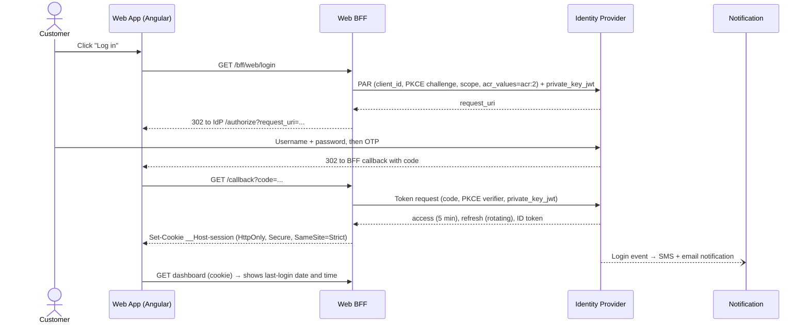
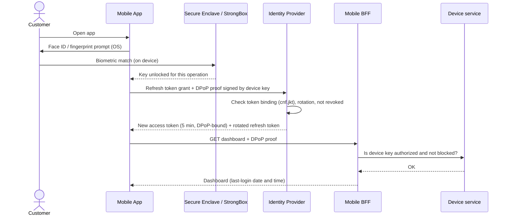
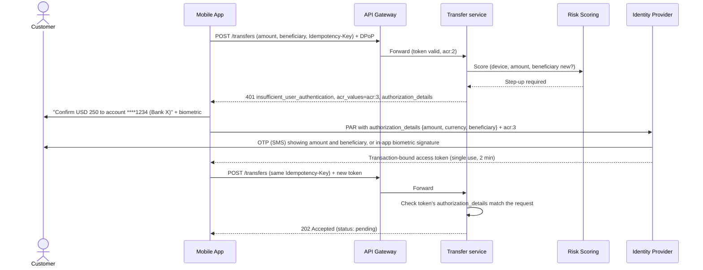

# Step 6: Authentication and authorization (OAuth 2.0 / OIDC)

**Inputs:** Step 0 (FR-02 login via the bank's OAuth 2.0 product, FR-03 biometric login, FR-15 step-up, QAS-10 stolen token, A-12 identity product capabilities), Step 2 (2-of-3 factors for login and transfers to unregistered accounts, authorized devices only, lockout after 3 failures, login notification, idle timeout, last-login display), Step 4 (Device service, Risk Scoring, API Gateway), Step 5 (Web BFF token handler, device key in secure hardware).

---

## 1. What the standards say

| Topic | Rule | Source |
| --- | --- | --- |
| Deprecated grants | **Implicit** and **Resource Owner Password Credentials** must not be used. Tokens in the URL leak; ROPC exposes the password to the client and can't do MFA. | RFC 9700 (OAuth 2.0 Security BCP, Jan 2025) |
| Public clients | Authorization Code + **PKCE** (S256) for every client, including confidential ones. | RFC 7636, RFC 9700 |
| Native apps | Log in through the **system browser** (ASWebAuthenticationSession / Custom Tabs), never an embedded WebView. Claimed HTTPS redirects (Universal / App Links). | RFC 8252 |
| Browser apps | Prefer a **BFF**: tokens stay on the server, the browser gets an HttpOnly cookie. | OAuth 2.0 for Browser-Based Apps (IETF BCP) |
| Financial-grade APIs | **FAPI 2.0 Security Profile**: PAR, PKCE, **sender-constrained tokens** (DPoP or mTLS), strong client authentication (`private_key_jwt` or mTLS), short-lived tokens. | OpenID FAPI 2.0 (final, 2025) |
| Pushed authorization requests | The authorization request is sent server-to-server first, so parameters can't be tampered with in the browser. | RFC 9126 (PAR) |
| Proof of possession | **DPoP**: each request carries a proof signed with the client's private key. A stolen token is useless without the key. | RFC 9449 |
| Step-up | The API returns `insufficient_user_authentication` with the required `acr_values`; the client re-authenticates at a higher level. | RFC 9470 |
| Transaction details | `authorization_details` carries the amount, currency and beneficiary, so consent and signature are bound to **this** transaction (dynamic linking). | RFC 9396 (RAR) |
| Passwordless / biometrics | FIDO2 / WebAuthn passkeys, or a device-bound key unlocked by native biometrics. | W3C WebAuthn, FIDO Alliance |

---

## 2. ADR-007: Authentication flows

**Status:** Proposed

**Context.** The bank already has an OAuth 2.0 product (A-12); we recommend the flows, not the product. Regulation requires 2 of 3 factors at login and for transfers to unregistered accounts, mobile transactions only from authorized devices, and lockout after 3 failures. QAS-10 requires that a stolen token can't move money.

**Decision.** Authorization Code + PKCE for both channels, following the **FAPI 2.0 Security Profile**:

| Channel | Client type | Client authentication | Token binding | Where tokens live |
| --- | --- | --- | --- | --- |
| Web (SPA) | **Web BFF = confidential client** | `private_key_jwt` (or mTLS) | mTLS between BFF and Gateway / or DPoP with a BFF key | Web BFF only (encrypted session store). Browser gets an HttpOnly cookie. |
| Mobile (Flutter) | **Public client** (+ app attestation) | PKCE + Play Integrity / App Attest verdict | **DPoP** with a **non-exportable key in Secure Enclave / StrongBox** | Device Keychain / Keystore |

Both use **PAR** and **PKCE**. Implicit and ROPC are disabled in the identity product.

### Justifications

1. **Meets QAS-10 directly.** Sender-constrained tokens (DPoP / mTLS) mean a stolen access or refresh token can't be replayed from another device. Combined with 5-minute access tokens and step-up for transfers, a leaked token can't move money.
2. **One security model, two channels.** Both follow the same profile (PAR, PKCE, bound tokens), so the API Gateway validates both the same way, and a new channel (QAS-15) reuses it.
3. **Industry standard for banking APIs.** FAPI is the profile used by open-banking regimes (UK, Brazil, Australia, Saudi Arabia). Using it gives the SB a recognised reference and keeps the APIs ready for future open-finance rules in Ecuador.
4. **Biometrics without sending biometric data.** The face or fingerprint only unlocks a key on the device. The bank never receives biometric data at login, which keeps login outside the LOPDP biometric-data processing rules (only onboarding processes biometrics, Step 7).

**Rejected:** ROPC (deprecated, can't do MFA); Implicit (deprecated); tokens in the browser's storage (XSS risk); passkeys synced across devices as the **mobile** login factor, because a synced passkey works on any of the user's devices, which breaks the "authorized devices only" rule. Passkeys remain an option for the **web** channel.

---

## 3. Factors and assurance levels

| Level (`acr`) | Factors | Used for |
| --- | --- | --- |
| `acr:1` | Password only | **Not allowed** for any session (regulation requires 2 of 3 at login). |
| `acr:2` (login) | **Knowledge + possession**: password + OTP (SMS or in-app), **or** **possession + inherence**: device key unlocked by biometrics | Login on web and mobile. Balances, movements, own-account transfers, transfers to **registered** beneficiaries within limits. |
| `acr:3` (step-up) | A **fresh** 2-factor confirmation **bound to the transaction** (dynamic linking) | Transfers to **unregistered** accounts, new beneficiary, limit increase, change of phone or email, device registration. |

Risk Scoring (Step 4) can raise the required level for any operation (new device, unusual amount, RASP alert, unusual location).

---

## 4. Flows

### 4.1 Web login (SPA → Web BFF → identity provider)

### 4.2 First mobile login and device binding

1. The app opens the **system browser** with a PAR-based request (RFC 8252). The customer enters username + password + OTP (`acr:2`).
2. The app gets an authorization code, then generates a **DPoP key pair** in Secure Enclave / StrongBox, marked **non-exportable** and **requiring biometric authentication** to use.
3. The token request includes a DPoP proof and the **App Attest / Play Integrity** verdict. The identity product issues **DPoP-bound** tokens (the token's `cnf.jkt` is the key's thumbprint).
4. The app calls `POST /devices` (Device service) with the public key and attestation. The Device service checks the attestation, **registers the device** as authorized, and triggers an SMS + email notification ("new device added"). Registering a device is an `acr:3` operation.

### 4.3 Biometric login (FR-03)

Two factors: **possession** (key that never leaves the device) + **inherence** (biometric that unlocks it). If the biometric fails or the customer changes enrolled fingerprints/faces (keys created with "invalidate on biometric enrolment change"), the app falls back to **password + OTP**, the non-biometric alternative required by the LOPDP biometric rule.

### 4.4 Step-up with dynamic linking (transfer to an unregistered account)

**Dynamic linking:** the token is valid only for this amount and beneficiary. If malware changes the beneficiary, the check fails. The OTP message shows the amount and the masked beneficiary, as PSD2 Strong Customer Authentication requires in Europe (used as a reference).

**Web step-up:** same flow through the Web BFF. The second factor is an OTP, or **approval in the mobile app** (push → biometric signature on the device), which also covers web customers who have the app. OpenID **CIBA** is the standard for this decoupled approval.

### 4.5 Lockout, recovery and session rules

| Rule (Step 2) | Implementation |
| --- | --- |
| Block after **3 failed attempts** | Identity product lockout policy. The lockout event is published → Notification sends SMS + email right away. |
| Secure reactivation | Self-service: biometric login on an authorized device + OTP; otherwise call center or branch identity check. |
| Login notification | IdP login event → Notification (SMS + email, 2 providers). |
| Last-login date and time | Customer Profile stores the previous successful login; shown on the dashboard. |
| Idle timeout | Web BFF: 5 min idle, absolute session limit (e.g. 30 min). Mobile: app locks after inactivity and requires biometrics again. |
| Change of phone or email | `acr:3` + notification to **both old and new** contacts. |
| Lost device / 24/7 blocking | Call center or web calls the Device service to **revoke the device key**; the IdP revokes its refresh tokens. |

---

## 5. Tokens

| Token | Lifetime | Binding | Notes |
| --- | --- | --- | --- |
| Access token (JWT) | **5 min** | DPoP (mobile) / mTLS or DPoP (Web BFF) | Claims: `sub`, `aud`, `scope`, `acr`, `auth_time`, `cnf`, `client_id`, `device_id`. No personal data beyond the subject ID. |
| Transaction token | **2 min, single use** | Same | Carries `authorization_details`. |
| Refresh token | Web: idle 5 min, absolute 30 min. Mobile: idle ~30 days, but every use needs the biometric-gated key | Sender-constrained, **rotated on every use** with reuse detection | Reuse of an old refresh token revokes the whole chain. |
| ID token | Login only | — | Only for the client to know who logged in; never sent to APIs. |

Signing: asymmetric (PS256 or ES256) with keys in KMS / HSM, published through JWKS and rotated regularly.

---

## 6. Authorization at the API Gateway and in services

| Layer | Check |
| --- | --- |
| **API Gateway** (coarse-grained) | JWT signature against cached **JWKS**, `iss`, `aud`, `exp`, `nbf`; **DPoP proof** (`htm`, `htu`, `iat`, `jti` replay cache, `ath`, key matches `cnf.jkt`); required **scope** per route (`accounts:read`, `transfers:write`, …); minimum `acr` per route; rate limit per customer and device. |
| **Mobile BFF / Device service** | Device ID in the token is registered and not revoked. |
| **Domain services** (fine-grained) | **Object-level authorization**: the account or beneficiary belongs to `sub` (prevents OWASP API Security #1, Broken Object Level Authorization). Transaction token matches the request. Limits. |
| **Service-to-service** | mTLS inside the cluster (service mesh), and the original user context propagated (token exchange, RFC 8693, or a signed internal header). |

**Introspection vs local validation:** validate JWTs **locally** at the gateway for latency (~5,000 req/s, A-05). Short lifetimes limit the revocation gap. For **money-moving** endpoints, also check a **revocation list** (device and session blocks) kept in a fast cache.

---

## 7. Identity product: what it must support

The product is provided by the bank (A-12). These are the capabilities this design needs; if the product lacks one, it can be added in front of it (e.g., PAR or DPoP handled by a gateway plugin).

| Capability | Needed for |
| --- | --- |
| OIDC, Authorization Code + PKCE, PAR | All flows |
| `private_key_jwt` / mTLS client authentication | Web BFF |
| **DPoP** (RFC 9449) | Mobile token binding (QAS-10) |
| Refresh token rotation with reuse detection | Both channels |
| `acr` / step-up (RFC 9470), `authorization_details` (RFC 9396) | Step-up, dynamic linking |
| MFA (OTP), lockout policy, events / webhooks | Regulation, notifications |
| JWKS, key rotation, revocation | Gateway validation |
| FAPI 2.0 certification (OpenID Foundation) | Evidence for the SB |

### Products that could be behind "the company's OAuth 2.0 product"

| Product | Fit | Notes |
| --- | --- | --- |
| **Keycloak** (Red Hat build) | Strong | Open source, self-hosted. Supports FAPI 2.0 client policies, DPoP, PAR, CIBA. The bank runs it, so it needs operations effort. |
| **Ping Identity / ForgeRock** | Strong | Common in banking, FAPI-certified products, strong fraud and journey tooling. Licence cost. |
| **Okta / Auth0** | Good | SaaS. Highly-regulated-identity features (PAR, JAR, mTLS). Data residency outside Ecuador: needs the SB cloud conditions (Step 2). |
| **Microsoft Entra External ID** | Medium | Good if the bank is on Microsoft. Fewer FAPI features; check DPoP and PAR support. |
| **Amazon Cognito** | Weak for this case | Cheap and native to AWS, but limited FAPI support (check DPoP, PAR, RAR). Better for simpler apps. |

---

## 8. Sources

- [RFC 9700: OAuth 2.0 Security Best Current Practice](https://www.rfc-editor.org/rfc/rfc9700)
- [RFC 7636: PKCE](https://www.rfc-editor.org/rfc/rfc7636)
- [RFC 8252: OAuth 2.0 for Native Apps](https://www.rfc-editor.org/rfc/rfc8252)
- [IETF: OAuth 2.0 for Browser-Based Applications](https://datatracker.ietf.org/doc/draft-ietf-oauth-browser-based-apps/)
- [OpenID FAPI 2.0 Security Profile](https://openid.net/specs/fapi-security-profile-2_0-final.html)
- [RFC 9126: Pushed Authorization Requests](https://www.rfc-editor.org/rfc/rfc9126)
- [RFC 9449: DPoP](https://www.rfc-editor.org/rfc/rfc9449)
- [RFC 9470: OAuth 2.0 Step Up Authentication Challenge](https://www.rfc-editor.org/rfc/rfc9470)
- [RFC 9396: Rich Authorization Requests](https://www.rfc-editor.org/rfc/rfc9396)
- [RFC 8693: Token Exchange](https://www.rfc-editor.org/rfc/rfc8693)
- [OpenID CIBA Core](https://openid.net/specs/openid-client-initiated-backchannel-authentication-core-1_0.html)
- [OWASP API Security Top 10 (2023)](https://owasp.org/API-Security/editions/2023/en/0x11-t10/)
- [Keycloak: FAPI and client policies](https://www.keycloak.org/docs/latest/server_admin/#_client_policies)
- [EBA: RTS on strong customer authentication (dynamic linking reference)](https://www.eba.europa.eu/regulation-and-policy/payment-services-and-electronic-money/regulatory-technical-standards-on-strong-customer-authentication-and-secure-communication-under-psd2)

---

## Step 6 checklist

- [x] Deprecated grants identified and excluded
- [x] Flow per channel chosen (ADR-007: Code + PKCE + PAR, FAPI 2.0, Web BFF confidential client, DPoP on mobile)
- [x] Biometric login designed (device-bound key, biometric unlock, non-biometric fallback)
- [x] Step-up with dynamic linking for transfers to unregistered accounts
- [x] Lockout, notifications, idle timeout and last-login display mapped to Step 2 rules
- [x] Token lifetimes, binding and rotation defined
- [x] Gateway and service-level authorization defined
- [x] Identity product capabilities and candidate products listed
- [ ] Draw the flows as Structurizr `dynamic` views in Step 17 (`05-Dynamic-Login-Web`, `05-Dynamic-Login-Biometric`, `05-Dynamic-StepUp-Transfer`)
- [ ] **Your review:** check the current FAPI / DPoP support of the product you think the bank uses
