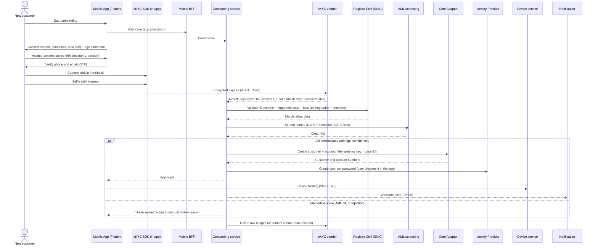

# Step 7: Onboarding with facial recognition

**Inputs:** Step 0 (FR-01 onboarding with facial recognition, QAS-11 presentation attacks), Step 2 (LOPDP biometric rule SPDP-SPD-2026-0039-R, UAFE KYC, 10-year record retention to verify), Step 4 (Onboarding service runs a Saga; biometric vendor behind an anti-corruption layer), Step 5 (vendor SDK in the Flutter app, consent screen), Step 6 (device binding, IdP user creation).

---

## 1. What onboarding must prove

| Question | Check | Required by |
| --- | --- | --- |
| Is the ID document real? | Capture front and back of the **cédula**, OCR, security features, barcode / MRZ | UAFE due diligence (KYC) |
| Is a real, live person in front of the camera? | **Liveness / presentation attack detection** (photo, video, mask, screen replay), plus **injection attack** detection (virtual cameras, deepfakes) | QAS-11 |
| Is it the same person as on the document? | **1:1 face match** selfie ↔ document photo | KYC |
| Does the identity exist and match the national registry? | **Registro Civil** (DIGERCIC) demographic + biometric validation | KYC, fraud prevention |
| Is the person allowed to be a customer? | Age ≥ 18, not deceased, **PEP / sanctions / UAFE list** screening, risk rating | UAFE, LOPDP (no biometrics of minors) |
| Can we reach them? | Phone and email verified with OTP | Notification rules (SMS + email, Step 2) |
| Did they agree? | Explicit, specific **consent** for biometric processing, plus terms and privacy notice | LOPDP biometric rule |

---

## 2. National identity registry (Registro Civil)

- The **Dirección General de Registro Civil, Identificación y Cedulación (DIGERCIC)** offers private legal entities access to the **Sistema Nacional de Identificación Ciudadana (SNIC)** for **demographic** or **demographic + biometric** validation, under an adhesion contract.
- **Price per query:** USD **0.15** demographic, USD **0.30** demographic + biometric (no VAT), billed monthly.
- Requirements include a confidentiality and personal-data agreement, information security policies, and two-factor access control.
- KYC vendors already expose it: **FacePhi** documents a Registro Civil Ecuador validation with face comparison (it needs the **fingerprint code** printed on the back of the cédula), and **Jumio** offers an "Ecuador Registry Civil Biometric Check" risk signal.
- **Caveat:** in April–May 2026 the SPDP investigated a possible leak of Registro Civil biometric data. A registry match alone isn't proof of presence, so it's always combined with liveness on the live capture.

**Decision:** the **bank holds the DIGERCIC contract** (it's the data controller and the obligated KYC party) and calls SNIC through its own **Registro Civil adapter**. If the chosen vendor offers a certified connector, it can be used at first, but the contract and the audit evidence stay with the bank.

Cost check: ~**USD 0.30** per onboarding for the registry. Even at 50,000 onboardings a month that's ~USD 15,000 a month, small compared with branch onboarding.

---

## 3. ADR-008: Biometric / eKYC approach and vendor

**Status:** Proposed (final vendor after a proof of concept)

**Context.** The bank needs document verification, certified liveness, face match, Registro Civil validation, and a mobile SDK usable from Flutter. Biometric data is sensitive under the LOPDP. The statement says onboarding uses facial recognition and is done in the mobile app.

### Option A vs B: build on cloud primitives, or buy an eKYC platform

| | A. Build on AWS Rekognition Face Liveness + CompareFaces + Textract | B. Specialist eKYC vendor |
| --- | --- | --- |
| Liveness | Yes (Face Liveness) | Yes, usually with iBeta PAD Level 2 test letters |
| Document verification (cédula security features) | **No**, only OCR. Must be built | Yes |
| Registro Civil Ecuador integration | Build | Some vendors have it already |
| Injection / deepfake defence | Partial | Core product focus for leading vendors |
| Fraud intelligence across customers | No | Yes (repeat-face, device and document fraud networks) |
| Time to market | Months | Weeks |
| Data residency | In the bank's AWS account | Vendor SaaS region, or in-account / on-prem deployment for some vendors |

**Decision: B, a specialist eKYC vendor**, behind the Onboarding service's anti-corruption layer.

### Vendor shortlist

Certification claims must be checked against the lab's confirmation letter (ISO/IEC 30107-3 has no levels; "Level 1/2/3" is **iBeta's** test programme).

| Vendor | Strengths | Points to check in the PoC |
| --- | --- | --- |
| **FacePhi** | Spanish company with many Latin American banks; documented **Registro Civil Ecuador** validation with face comparison; document + selfie + liveness SDK | iBeta letter; Flutter plugin; deployment and data-residency options |
| **Jumio** | Full KYC platform; **Ecuador Registry Civil check** available; AML screening add-ons | Data processed in the US; pricing |
| **Veridas** | Spanish biometrics vendor with LATAM presence; on-prem / private-cloud option | Ecuador registry connector |
| **iProov** | Strong liveness and injection-attack defence (used by governments) | No document verification on its own: needs a partner |
| **FaceTec** | 3D liveness, widely embedded by other vendors | Sold through integrators; document verification separate |
| **Onfido (Entrust)** | Mature document + biometric KYC | Ecuador registry; LATAM support |
| **AWS Rekognition Face Liveness** | Native to AWS, data stays in the account, low cost | Liveness only (Option A) |
| **Azure AI Face** | Liveness available | **Limited Access**: requires Microsoft approval; liveness only |

**Recommendation:** run a PoC with **FacePhi** (preferred: existing Ecuador registry integration and LATAM banking track record) and **Jumio** (alternative), measuring false acceptance / false rejection on real cédulas, completion rate on low-end Android phones, latency, and injection-attack resistance.

### Justifications

1. **Regulatory weight is in document + registry + liveness together.** Only specialist vendors cover all three today, including a Registro Civil connector. Building document verification for the cédula in-house would add months and fraud risk.
2. **Certified, independently tested liveness** (iBeta PAD Level 2, ISO/IEC 30107-3) gives auditable evidence for QAS-11 and for the SB. Leading vendors also defend against **injection attacks** (CEN/TS 18099), which ISO 30107-3 doesn't cover.
3. **Swappable by design.** The anti-corruption layer (Step 4) maps vendor results to our own model (`DocumentVerified`, `LivenessPassed`, `FaceMatchScore`), so changing vendor doesn't touch the Saga. Vendor lock-in is limited to the SDK in the app.

---

## 4. Onboarding flow (Saga)

### Saga steps and failure handling

| Step | Owner | On failure |
| --- | --- | --- |
| 1. Consent, age, contact OTP | Onboarding | Stop. Nothing stored except the abandoned case (deleted after 7 days). |
| 2. Document + liveness + face match | Vendor (via SDK) | Up to 3 retries, then offer **assisted / branch onboarding** (non-biometric alternative). |
| 3. Registro Civil validation | Registro Civil adapter | Registry down: keep case **pending** and retry with backoff; the customer is notified when done. Mismatch: manual review. |
| 4. AML screening | AML Monitoring / screening provider | Hit: manual review by compliance. Never auto-reject. |
| 5. Create customer and account in the Core | Core Adapter | Idempotent call (case ID). Retry. If it finally fails: case stays pending, ops alert. |
| 6. Create IdP user | Onboarding | Retry (idempotent). **No compensation of the account**; the account is opened but blocked until the user exists. |
| 7. Device binding + biometric login enrolment | Device service | Can be repeated by the customer at next login. |
| 8. `OnboardingCompleted` event | Outbox | Audit, Notification, AML Monitoring, Customer Profile consume it. |

The Saga is **orchestrated** by the Onboarding service (one place shows the case status, which helps manual review and audit). Each step is idempotent, and state is saved after each step so the customer can **resume** an interrupted onboarding.

**Human in the loop:** rejections and borderline cases go to a **manual review queue** in the back office. This satisfies the LOPDP rule that decisions with legal effects can't be based solely on automated biometric identification.

---

## 5. Biometric data: what is stored, where, for how long

| Data | Stored? | Where | Retention |
| --- | --- | --- | --- |
| Raw selfie, liveness video, raw document images | **Only during verification** | Vendor (encrypted) | **Deleted after the decision** (contractual, e.g. ≤ 24 h). Manual-review cases: until the review ends. |
| Face **template** | **No** (by default) | — | Not needed: login uses on-device biometrics (Step 6). Account recovery repeats liveness + Registro Civil match. |
| Document data (name, ID number, DOB, nationality) | Yes | Onboarding store → Customer Profile / Core | KYC record retention (**≥ 10 years**, to verify, Step 2) |
| Verification evidence (vendor transaction ID, scores, decision, reviewer, timestamps) | Yes | Onboarding store + **Audit (WORM)** | Same as KYC records |
| Consent record (text version, timestamp, device, IP) | Yes | Audit (WORM) | Same as KYC records |

Additional rules (Step 2, LOPDP biometric rule):

- **DPIA** before go-live, reviewed every 12 months.
- Biometric data is **sensitive**: separate encrypted store with its own KMS key, minimal access, every access audited.
- Vendor signs a **processing agreement** (vendor as processor), no secondary use, no training on bank data without explicit agreement. If it processes data outside Ecuador as a processor, the cloud-processor treatment from Step 2 applies; check its role and location.
- **No minors:** age ≥ 18 checked from the document and the registry.

---

## 6. Security of the onboarding channel

| Threat | Control |
| --- | --- |
| Presentation attack (photo, screen, mask) | Certified liveness (iBeta PAD Level 2) |
| Injection attack (virtual camera, emulator, deepfake stream) | Vendor injection-attack detection, **RASP** + **App Attest / Play Integrity** (Step 5), capture only through the SDK |
| Synthetic or stolen identity | Registro Civil biometric match + document checks + vendor fraud signals (repeat face / document across applications) |
| Mass account creation (mule accounts) | Rate limits per device and IP, risk scoring, AML screening, limits on new accounts for the first days |
| Tampered vendor result | Results fetched **server-to-server** by the Onboarding service (signed callback or API pull), never trusted from the app |

---

## 7. Sizing

Onboarding is low volume compared with transactions: even 50,000 new digital customers a month is ~2,500 a working day. The Onboarding service is **T2**: it scales separately and its failure never affects login, balances or transfers (Step 4 bulkheads).

---

## 8. Sources

- [gob.ec: SNIC demographic / demographic + biometric verification for private entities](https://www.gob.ec/dgrcic/tramites/verificacion-sistema-nacional-identificacion-ciudadana-consulta-demografico-demografico-mas-biometrico-0)
- [gob.ec: demographic web service validation](https://www.gob.ec/dgrcic/tramites/validacion-mediante-consulta-datos-web-service-demografico)
- [DIGERCIC Res. 005-2026: sectorized information catalogue (via Asobanca)](https://asobanca.org.ec/wp-content/uploads/2026/05/Res.-005-DIGERCIC-CGAJ-DPyN-2026-Catalogo-sectorizado-de-informacion.pdf)
- [FacePhi: Registro Civil Ecuador civil validation](https://docs.facephi.com/docs.facephi-en/rest-api/identity-api/identity-api-reference/onboarding/civil-validation/ecuador)
- [Jumio: Ecuador Registry Civil Biometric Check](https://docs.jumio.com/production/Content/References/Risk%20Signals/Ecuador%20Registry%20Check.htm)
- [Primicias: new rules for biometric data in Ecuador](https://primicias.ec/sociedad/imagen-huella-rostro-voz-datos-biometricos-personales-norma-ecuador-132986/)
- [Biometric Update: vendors clearing iBeta PAD Level 2 (Aug 2026)](https://www.biometricupdate.com/202608/five-vendors-clear-ibeta-pad-level-2-as-biometric-security-benchmark-rises)
- [ID Tech: Level 2 becomes the norm](https://idtechwire.com/ibeta-liveness-certifications-point-to-a-market-shift-as-level-2-becomes-the-norm/)
- [AWS: Rekognition Face Liveness](https://docs.aws.amazon.com/rekognition/latest/dg/face-liveness.html)
- [Microsoft: Azure AI Face liveness (Limited Access)](https://learn.microsoft.com/en-us/azure/ai-services/computer-vision/concept-face-liveness-detection)

---

## Step 7 checklist

- [x] eKYC checks defined (document, liveness, face match, registry, AML, contact, consent)
- [x] National registry access confirmed (DIGERCIC SNIC, USD 0.15 / 0.30 per query)
- [x] Build vs buy decided, vendor shortlist and PoC plan (ADR-008)
- [x] Onboarding Saga with failure handling and manual review
- [x] Hand-off to the Core, the identity provider and device binding
- [x] Biometric data storage and retention defined (no templates kept)
- [x] Onboarding threats and controls
- [x] Draw `05-Dynamic-Onboarding` in Structurizr (Step 17)
- [x] Check the iBeta confirmation letters of the shortlisted vendors: both Level 2. FacePhi SelphID 3.3.0.78 ([iBeta letter, Mar 2022](https://www.ibeta.com/wp-content/uploads/2022/03/220303-FacePhi-PAD-Level-2-Confirmation-Letter.pdf)); Jumio Liveness PAD SDK 5.11.0 ([Jumio, Oct 2025](https://www.jumio.com/about/press-releases/iso-iec-level-2-compliance/)). The PoC must use the tested SDK version or ask for a re-test.
- [ ] **Your review:** confirm the technical integration method of SNIC (the gob.ec page doesn't say it's a web service)

---

## Update (8 Nov 2026): onboarding components (C4 level 3)

New component view `03-Components-Onboarding`, in three layers:

- **API layer:** Onboarding API (safe status messages only), **Device Attestation Verifier** (Play Integrity / App Attest checked server-side before any capture), **Vendor Webhook Endpoint** (HMAC signature, timestamp, replay protection; the result is never taken from the app), **Manual Review API** (staff role, **four-eyes rule**).
- **Business layer:** Onboarding Orchestrator (state machine `STARTED → CAPTURED → VERIFIED → SCREENED → APPROVED | UNDER_REVIEW | REJECTED → ACTIVE`, consent recorded) and **Decision Engine** (vendor scores + registry match + screening → approve / review / reject; rejections always reviewed by a person).
- **Integration and data layer:** eKYC Vendor Adapter (ACL, polls if a webhook is lost), Registro Civil Adapter, Screening Client (PEP, sanctions, UAFE lists, duplicate identities), Account Opening Client, **IdP Provisioning Client** (creates the user with `kyc_level=verified`), Case Repository & Outbox.

Staff use a new **Back-office Portal** (staff SSO + FIDO2 MFA) for manual review.
