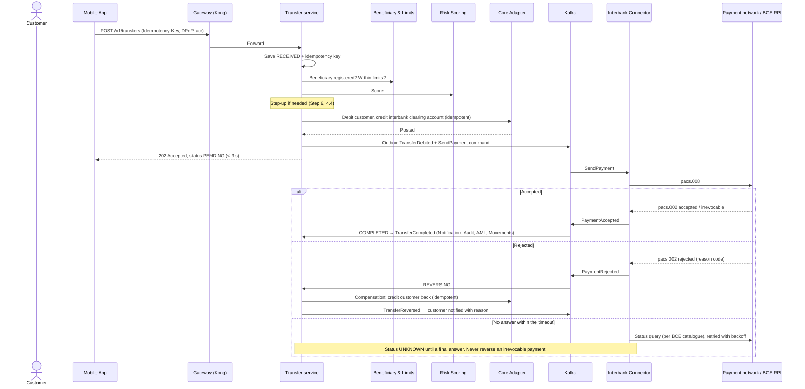

# Step 8: Integration layer and communication patterns

**Inputs:** Step 0 (FR-07/12/13, QAS-03/05/08/09/15, A-05 ~5,000 req/s at the gateway, A-11 on-premises Core with limited capacity, A-13 interbank), Step 2 (BCE SPI and real-time payments standard), Step 3 (AWS us-east-1 + us-east-2, Direct Connect to the Core, lock-in mitigation), Step 4 (14 services, first cut of sync vs async), Step 6 (token validation at the gateway, DPoP, mTLS between services).

---

## 1. Interbank payments in Ecuador (what the connector must speak)

From **Res. BCE-GG-007-2026** (Registro Oficial, 17 Mar 2026), the real-time payments messaging standard:

| Element | Rule |
| --- | --- |
| Message standard | **ISO 20022**. A payment order is a **`pacs.008`**. The beneficiary bank's answer (accept / reject) and the irrevocability notice are **`pacs.002`**. |
| Payment keys (aliases) | Looking up the account behind a payment key (an alias such as a phone number) uses **`acmt`** messages. |
| Networks | **Payment networks** (intra-network payments) and the BCE's **Red de Pagos Instantáneos (RPI)**. Payments between different networks go through the BCE's **Sistema Integrador de Pagos (SIP)**. |
| Order of operations | The ordering bank must **debit the customer first**, then send the `pacs.008` (art. 7). |
| Validation | The beneficiary bank checks the account and ID match its customer, and rejects otherwise (art. 10). |
| Irrevocability | Once accepted and declared irrevocable (a `pacs.002`), the payment **can't be reversed** (art. 9, 12, 13). |
| Timeouts | A maximum wait for key resolution, orders and responses, set by the BCE in the technical catalogue. |
| Deadline | Intra-network messaging by **30 Nov 2026**. Inter-network once the SIP is in production. |
| Amount cap | Initially **one basic salary** per real-time payment (Step 2). Larger amounts use the **SPI** (deferred, batch settlement). |

**Design consequences**

1. The Interbank Connector is **two-way**: it **sends** `pacs.008` for outgoing payments and **receives** `pacs.008` for incoming payments (credit the customer, answer with `pacs.002` within the timeout, notify), plus it **answers `acmt` key lookups** about BP's customers.
2. Two routes chosen by amount and availability: **real-time** (≤ cap, final status in seconds) and **SPI** (above the cap, final status after the batch cycle).
3. A missing answer is **not** a rejection. After a timeout the status is **unknown** and must be resolved by a status query before any reversal.

---

## 2. Communication style

| Interaction | Style | Protocol | Why |
| --- | --- | --- | --- |
| Apps → BFFs → Gateway → services | Synchronous | HTTPS, REST/JSON, OpenAPI 3.1 | The user is waiting. REST is understood by every tool in the chain (WAF, gateway, tracing). |
| Service → service (decisions before money moves) | Synchronous, with timeouts and circuit breakers | REST over mTLS | Transfer needs Limits and Risk answers before debiting. |
| Transfer → Interbank Connector | **Asynchronous command** | Kafka topic | Settlement can take seconds (RPI) or hours (SPI). FR-13 status tracking. |
| Domain events → Notification, Audit, AML, read models | **Asynchronous events** | Kafka topics | Must never slow down or break the critical path. Several consumers, replay possible. |
| Core Adapter → Core | Synchronous | The Core's REST/SOAP over Direct Connect | Anti-corruption layer translates the Core's model. |
| Interbank Connector ↔ payment network / BCE | Per network specification | ISO 20022 over the network's channel (mTLS) | Regulatory standard. |

**gRPC not adopted** at first: there are few chatty internal calls, and REST keeps one toolchain for security, tracing and the gateway. Revisit for Transfer → Risk Scoring if that hop becomes a latency problem.

---

## 3. ADR-009: API Gateway

**Status:** Proposed

**Context.** The gateway is the single entry point (C-04, FR-12): ~5,000 req/s design peak (A-05), routing by transaction type, JWT + **DPoP** validation and minimum `acr` per route (Step 6), rate limiting per customer and device, mTLS to services, deployed identically in us-east-1 and us-east-2.

| Criterion | Weight | Kong Gateway (on EKS) | Amazon API Gateway | Apigee | Azure API Management |
| --- | --- | --- | --- | --- | --- |
| Security features (JWT, mTLS, DPoP / FAPI via plugins, fine-grained rate limits) | 25% | 5 | 3 | 4 | 3 |
| Latency and throughput at 5,000 req/s | 20% | 5 | 4 | 4 | 3 |
| Fit with AWS (ADR-002) and the multi-region design | 15% | 4 | 5 | 3 | 1 |
| Portability (lock-in mitigation, ADR-002) | 15% | 5 | 2 | 3 | 2 |
| Cost at billions of requests a month | 10% | 4 | 3 | 2 | 3 |
| Operational effort | 10% | 3 | 5 | 4 | 4 |
| Developer portal and API lifecycle | 5% | 4 | 3 | 5 | 4 |
| **Weighted total** | 100% | **4.50** | **3.55** | **3.55** | **2.70** |

**Decision:** **Kong Gateway**, running on EKS in both regions, behind CloudFront + WAF + an internal Network Load Balancer.

### Justifications

1. **Banking-grade token checks at the edge of the platform.** Kong's plugin model supports OIDC/JWT validation, mTLS and custom plugins (DPoP proof checks, `acr` per route, replay cache in Redis). Amazon API Gateway would need a Lambda authorizer for DPoP on every call, adding latency and cost.
2. **Predictable cost at high volume.** Amazon API Gateway charges per request; at ~5,000 req/s peak this is billions of requests a month and grows linearly with traffic. Kong's cost is mostly compute and licence, which grows in steps.
3. **Portable and declarative.** Configuration lives in Git (decK / Kubernetes CRDs) and runs the same way on any Kubernetes. That's the lock-in mitigation promised in ADR-002, and both regions get exactly the same routes.

**Trade-off:** the bank operates the gateway (patching, scaling, HA). Mitigated by running it on EKS with the same automation as the services, and by Kong's enterprise support. Amazon API Gateway is the fallback if the bank prefers a fully managed service.

### Gateway responsibilities

| Responsibility | Where |
| --- | --- |
| TLS termination, WAF (OWASP rules, bot control), DDoS | CloudFront + AWS WAF + Shield (edge) |
| Token validation (JWT, DPoP, scopes, `acr`), revocation list | Kong |
| Routing by transaction type (FR-12): `/accounts`, `/movements`, `/transfers`, `/beneficiaries`, `/profile`, `/devices`, `/onboarding` | Kong |
| Rate limiting (per customer, per device, per IP) and **load shedding** (history queries shed before transfers) | Kong |
| Request size limits, schema validation of request bodies | Kong |
| Correlation ID injection, access logs → Audit and observability | Kong |
| Versioning: major version in the path (`/v1/`), additive changes only within a version, `Deprecation` / `Sunset` headers | Kong + API governance |
| **Strangler fig:** routes not yet migrated can point to the bank's current online banking backend, so traffic moves service by service | Kong |
| Response caching | Only **non-personal reference data** (bank list, BIC catalogue, FX table). Personal data is cached inside services (Step 9). |

---

## 4. ADR-010: Messaging

**Status:** Proposed

| Criterion | Weight | Amazon MSK (Kafka) | SQS / SNS / EventBridge | Confluent Cloud |
| --- | --- | --- | --- | --- |
| Replay (rebuild read models, re-feed Audit and AML) | 25% | 5 | 2 | 5 |
| Ordering per key (all events of one account in order) | 20% | 5 | 3 (FIFO, lower throughput) | 5 |
| Several independent consumers of the same event | 15% | 5 | 4 | 5 |
| CDC from the Core and connectors (Kafka Connect, Debezium) | 15% | 5 | 2 | 5 |
| Operational effort | 10% | 3 | 5 | 4 |
| Cost | 10% | 4 | 4 | 3 |
| Data stays in the bank's AWS account (one provider in the SB dossier) | 5% | 5 | 5 | 2 |
| **Weighted total** | 100% | **4.70** | **3.15** | **4.55** |

**Decision:** **Amazon MSK (Apache Kafka)**, provisioned, 3 AZs in us-east-1, replicated to us-east-2 with **MSK Replicator**.

### Justifications

1. **Events are the bank's history.** Kafka keeps events for a configured time, so Audit, AML and the Movements read model can be **rebuilt by replaying** topics after a bug or a new consumer. Queues delete a message once consumed.
2. **Order per account.** Partitioning by account ID keeps all events of an account in order (debit before reversal, balance updates in sequence), at thousands of messages per second.
3. **One backbone for events and CDC.** Kafka Connect / Debezium can stream changes from the Core (Step 9) into the same platform, and the protocol is open (lock-in mitigation).

Confluent Cloud is a close alternative (less operations, schema governance included) at a higher price. **No second broker**: retries and dead letters are handled with Kafka retry and DLQ topics, so the team runs one messaging technology.

### Topic conventions

| Topic (examples) | Key | Producers → consumers |
| --- | --- | --- |
| `transfers.events.v1` (`TransferRequested`, `TransferDebited`, `TransferCompleted`, `TransferFailed`, `TransferReversed`) | account ID | Transfer → Notification, Audit, AML, Accounts, Movements |
| `interbank.commands.v1` (`SendPayment`) | transfer ID | Transfer → Interbank Connector |
| `interbank.events.v1` (`PaymentAccepted`, `PaymentRejected`, `PaymentIrrevocable`, `IncomingPaymentCredited`) | transfer ID | Interbank Connector → Transfer, Notification, Audit, AML |
| `customer.events.v1`, `device.events.v1`, `onboarding.events.v1`, `security.events.v1` (logins, lockouts) | customer ID | … → Notification, Audit, AML, Risk |
| `*.retry.*`, `*.dlq` | same | Retry with backoff; DLQ with alert and replay tooling |

Schemas in a **schema registry** (AWS Glue Schema Registry or Apicurio), Avro or JSON Schema, backward-compatible evolution only. Events carry **IDs, not personal data** where possible (consumers fetch details they're allowed to see), which limits personal data spread across topics.

---

## 5. ADR-011: Compute

**Status:** Proposed

| Criterion | Weight | Amazon EKS | ECS on Fargate | AWS Lambda |
| --- | --- | --- | --- | --- |
| Steady high load, low latency, long-lived connections to the Core and Kafka | 25% | 5 | 5 | 2 |
| Portability (ADR-002) | 20% | 5 | 2 | 1 |
| Runs the platform pieces (Kong, mesh, Kafka consumers autoscaled by lag) | 20% | 5 | 3 | 2 |
| Auto-healing and auto-scaling (QAS-09, QAS-14, QAS-16) | 15% | 5 | 4 | 5 |
| Operational effort | 10% | 3 | 5 | 5 |
| Cost at steady load | 10% | 5 | 3 | 3 |
| **Weighted total** | 100% | **4.80** | **3.65** | **2.65** |

**Decision:** **Amazon EKS** for the BFFs, Kong and all domain services. **Lambda** only for glue tasks (S3 events, scheduled reports), never on the transaction path.

### Justifications

1. **Portability and one platform.** Kubernetes runs the gateway, the services and the mesh the same way in both regions, and keeps the application layer portable to another cloud or on-premises if regulation or cost requires it.
2. **Auto-healing and elastic cost.** Liveness/readiness probes restart or replace failing pods (QAS-14). **Karpenter** adds nodes in under a minute for payday peaks (QAS-09) and removes them at night (QAS-16). **KEDA** scales Kafka consumers by consumer lag.
3. **Right for a steady, latency-sensitive load.** Long-lived connection pools to the Core and Kafka, no cold starts, and Graviton (ARM) nodes with Savings Plans make it cheaper than per-invocation pricing at this volume.

**Trade-off:** EKS needs platform skills. Mitigated with managed node groups / EKS Auto Mode, GitOps (Argo CD) and a small platform team. ECS Fargate is the fallback if the bank has no Kubernetes experience.

### Service stack (BFFs and domain services)

**Java 21 + Spring Boot 3** (virtual threads for high-concurrency I/O, mature banking ecosystem, ISO 20022 libraries, Resilience4j, OpenTelemetry). One stack for all services keeps hiring, libraries and security patching simple; a different language is allowed only with an ADR.

### Service mesh

**Adopted: Istio in ambient mode** (no sidecars). It gives **mTLS between all services** with automatic certificate rotation (Step 6), identity-based authorization policies (only Transfer may call Core Adapter's posting API), and uniform telemetry. Ambient mode avoids the CPU and latency cost of a sidecar per pod.

**Rule to avoid retry storms:** retries are configured in **one place only**, the calling service (Resilience4j), not in the mesh as well.

---

## 6. Resilience patterns and where they apply

| Pattern | Where | Quality attribute |
| --- | --- | --- |
| **Timeout** | Every outbound call. Core: 2 s; Risk/Limits: 300 ms; vendors: per SLA | QAS-03, QAS-08 |
| **Retry with exponential backoff + jitter** | Only **idempotent** operations (reads, calls with an idempotency key). Max 2–3 attempts | QAS-03 |
| **Circuit breaker** | Core Adapter, Customer Info Adapter, notification providers, eKYC vendor, Registro Civil | QAS-03, QAS-04 |
| **Bulkhead** | Separate connection pools in the Core Adapter for **reads** and **postings**, so a flood of history queries can't block transfers | QAS-03, QAS-09 |
| **Rate limiting toward the Core** | Token bucket in the Core Adapter sized to the Core's capacity (A-11). Excess reads are served from cache / read model | QAS-03 |
| **Fallback** | Balances and movements from cache or read model, marked "as of hh:mm" | QAS-03, QAS-06 |
| **Idempotency key** | Every money-moving request. Stored with the result; a retry returns the same result | QAS-05 |
| **Transactional outbox** | Every service that changes state and publishes an event (Transfer, Onboarding, Beneficiary, Device) writes both in **one DB transaction**; a relay publishes to Kafka | Consistency, FR-10 (no lost audit events) |
| **Idempotent consumer (inbox)** | Every Kafka consumer stores processed event IDs; duplicates are ignored (Kafka delivers at least once) | QAS-05 |
| **Saga (orchestrated)** | Transfers (below) and onboarding (Step 7) | Consistency without distributed transactions |
| **Anti-corruption layer** | Core Adapter, Customer Info Adapter, Interbank Connector, eKYC adapter | NFR-10, QAS-15 |
| **API composition** | BFFs aggregate several services into one screen response | QAS-06 |
| **Strangler fig** | Gateway routing during migration from the current online banking | Migration risk |
| **Load shedding / priority** | Gateway sheds low-priority traffic (history export) before transfers under overload | QAS-09 |

---

## 7. Transfer Saga

### 7.1 Own-account transfer (FR-06)

A single posting in the Core (debit and credit in one Core transaction), so no compensation is needed. The Transfer service still records the order with its idempotency key and publishes events through the outbox. Target p95 < 3 s (QAS-08).

### 7.2 Interbank real-time transfer (FR-07)

Orchestrated by the **Transfer service** as a persisted state machine:

```text
RECEIVED → VALIDATED → DEBITED → SENT → COMPLETED
                │           │       ├─(pacs.002 reject)──→ REVERSING → FAILED (reversed)
                │           │       └─(timeout)──→ UNKNOWN → status query → COMPLETED | REVERSING
                └─(limits / risk / step-up fail)──→ REJECTED (nothing debited)
```



| Step | Compensation |
| --- | --- |
| Validation, limits, risk | None needed (nothing has happened yet) |
| Debit to the clearing account | **Credit back** to the customer (reversal posting), only after a **final** rejection |
| `pacs.008` sent | Can't be cancelled once irrevocable. A mistaken payment follows the network's return / claims process (back office) |

The SPI route (above the real-time cap) uses the same state machine, but `SENT → COMPLETED` happens after the SPI batch cycle, and returns can arrive later as a separate incoming message that triggers the reversal.

### 7.3 Incoming interbank payment

`pacs.008` received → Interbank Connector validates the account and ID belong to the customer (art. 10) → Core Adapter credits the customer (idempotent on the message ID) → `pacs.002` accept within the network timeout → `IncomingPaymentCredited` event → Notification, Audit, AML, Movements. This path is **T1**: a slow answer is a failed payment for another bank's customer.

---

## 8. Resulting platform view (for the Step 17 container diagram)

```text
CloudFront + WAF + Shield
   └─ NLB → Kong Gateway (EKS) ──► BFFs ──► domain services (EKS, Istio ambient mTLS)
                                              ├─ Aurora / Redis per service (Step 9)
                                              ├─ MSK (Kafka) + schema registry
                                              ├─ Core Adapter ──Direct Connect──► Core (on-prem)
                                              ├─ Customer Info Adapter ──► Complementary system
                                              └─ Interbank Connector ──ISO 20022──► payment network / BCE
```

---

## 9. Sources

- [Res. BCE-GG-007-2026: real-time payment messaging standard (Registro Oficial, 17 Mar 2026)](https://asobanca.org.ec/wp-content/uploads/2026/03/RO-Res.-BCE-GG-007-2026-Estandar-mensajeria-transferencias-electronicas-pago-tiempo-real.pdf)
- [BCE circular: SPI technical norm v2 (Mar 2026)](https://asobanca.org.ec/wp-content/uploads/2026/03/Circular-BCE-GMPSN-2026-008-C-Cambio-SPI-LAFT.pdf)
- [ISO 20022 message definitions (pacs, acmt)](https://www.iso20022.org/iso-20022-message-definitions)
- [Kong Gateway documentation](https://docs.konghq.com/gateway/latest/)
- [Amazon API Gateway quotas](https://docs.aws.amazon.com/apigateway/latest/developerguide/limits.html) and [pricing](https://aws.amazon.com/api-gateway/pricing/)
- [Amazon MSK Replicator](https://docs.aws.amazon.com/msk/latest/developerguide/msk-replicator.html)
- [Istio ambient mode](https://istio.io/latest/docs/ambient/overview/)
- [Karpenter](https://karpenter.sh/) and [KEDA Kafka scaler](https://keda.sh/docs/latest/scalers/apache-kafka/)
- [microservices.io: Saga, Transactional Outbox, Idempotent Consumer, API Composition](https://microservices.io/patterns/)
- [AWS Prescriptive Guidance: cloud design patterns (circuit breaker, saga, strangler fig, outbox)](https://docs.aws.amazon.com/prescriptive-guidance/latest/cloud-design-patterns/introduction.html)

---

## Step 8 checklist

- [x] Interbank standard researched (ISO 20022 `pacs.008` / `pacs.002`, `acmt` keys, RPI / SIP, irrevocability, 30 Nov 2026 deadline)
- [x] Sync vs async defined per interaction; REST chosen, gRPC deferred
- [x] Gateway chosen (ADR-009: Kong on EKS) with responsibilities
- [x] Messaging chosen (ADR-010: Amazon MSK) with topic conventions
- [x] Compute chosen (ADR-011: EKS; Lambda only for glue), service stack and service mesh
- [x] Resilience patterns mapped to quality attributes
- [x] Transfer Saga with compensation, timeout handling and incoming payments
- [ ] Draw `05-Dynamic-Transfer-Interbank` in Structurizr (Step 17)
- [ ] **Your review:** check whether BP connects to the RPI directly or through a private payment network, and the timeout values in the BCE technical catalogue

---

## Update (8 Nov 2026): transfer operations

- **Compensation Handler** component: on final rejection or expiry, reverses the debit, publishes `TransferFailed` / `TransferReversed`, and opens a **manual operations case** for anything it can't resolve.
- **Reconciliation Job**: compares transfers with Core postings and interbank **settlement reports**; every difference becomes a case.
- **Operations Case API**: staff resolve cases from the Back-office Portal.
- `POST /v1/transfers` returns **202 Accepted with a status URL** for interbank transfers.
